<div align="center">

# ☕ coffee_screen

**A controller for an espresso machine on an Arduino Nano, built and used on an Ascaso Steel Uno Pro.**

A round colour screen, one rotary encoder, a PID-controlled boiler, a pump, a 3-way valve and two flow
sensors that measure the volume in the cup. Everything is done with a single knob: turn to change a value,
push to brew.


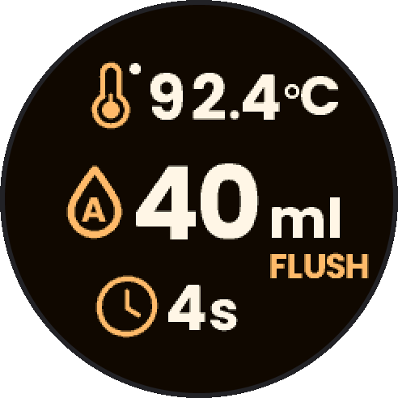

-00979D)


[Screens](#-the-screens) · [Using it](#-using-the-machine) · [Extraction](#-extraction-phases) ·
[Calibration](#-cup-volume-and-calibration) · [Safeties](#-safeties) · [Hardware](#-hardware-and-wiring) ·
[Configuration](#-configuration) · [Build](#-build-and-upload) · [Tests](#-tests) ·
[Architecture](#-code-architecture)

</div>

| | |
|---|---|
| **Machine** | Ascaso Steel Uno Pro (the one this project is built and used on) |
| **Screen** | GC9A01 round display, 240 x 240 |
| **Input** | CJMCU-111 rotary encoder with push button |
| **Temperature** | MAX31865 amplifier + PT100 probe, PID with feedforward on the water flow |
| **Brewing** | pump relay, 3-way valve relay, flow sensors "In" (A0) and "Out" (A1, OPV return) |
| **Settings** | saved automatically in the EEPROM |

> [!WARNING]
> This code is not a substitute for an independent thermal fuse / thermostat on the boiler.
> You work on a mains-powered machine with hot water and pressure: do it at your own risk.

---

## 🖥 The screens

The screen shows three values: the **temperature** (°C), the **volume** (ml) and the **duration** (s).
The **drop** carries the mode letter (**A** = AUTO, **M** = MANUAL). The small dot next to the thermometer
is lit while the heater is on. The parameter being edited is shown with **large digits**.

### AUTO: an extraction

<table>
<tr>
<td align="center"><br><b>Ready</b><br>target volume, 0 s</td>
<td align="center">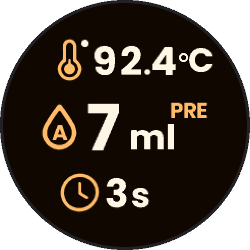<br><b>Pre-infusion</b><br>ml left to send</td>
<td align="center">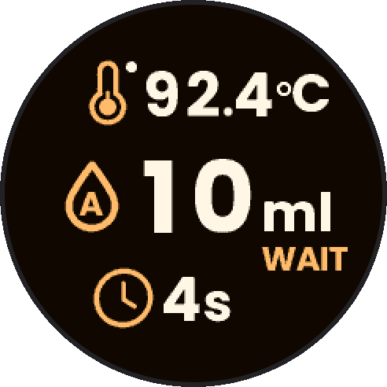<br><b>Wait</b><br>seconds left of the soak</td>
</tr>
<tr>
<td align="center"><br><b>Extraction</b><br>volume in the cup, time</td>
<td align="center">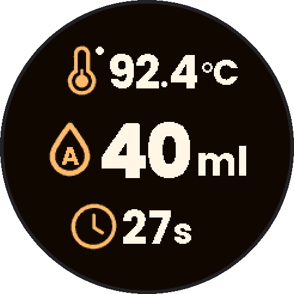<br><b>Result</b><br>stays 10 s (blinks during the last 3 s), then the target comes back</td>
<td align="center"><br><b>Flush, waiting</b><br>push to rinse the grouphead</td>
</tr>
<tr>
<td align="center"><br><b>Flushing</b><br>the tag blinks, countdown</td>
<td></td>
<td></td>
</tr>
</table>

### Settings: the double push cycle

<table>
<tr>
<td align="center">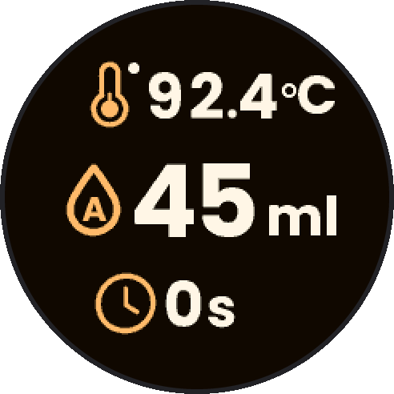<br><b>Volume</b><br>target in the cup</td>
<td align="center">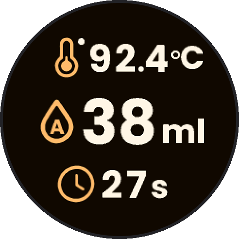<br><b>CAL</b><br>real weight of the cup</td>
<td align="center"><br><b>PRE</b><br>pre-infusion volume</td>
</tr>
<tr>
<td align="center">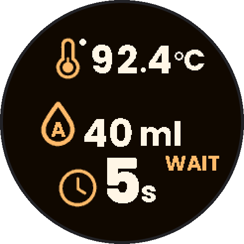<br><b>WAIT</b><br>soak time</td>
<td align="center"><br><b>FLUSH</b><br>rinse time</td>
<td align="center">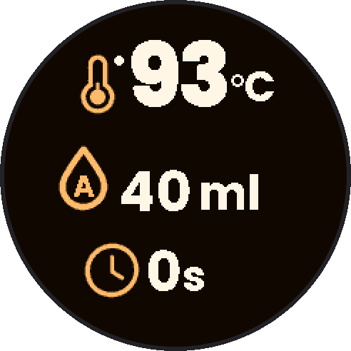<br><b>Temperature</b><br>water setpoint</td>
</tr>
</table>

### MANUAL mode and errors

<table>
<tr>
<td align="center">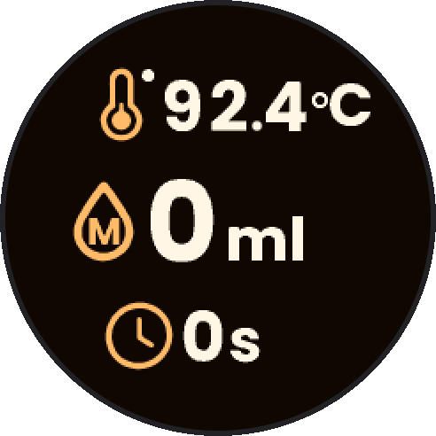<br><b>MANUAL, ready</b><br>letter M, volume 0</td>
<td align="center">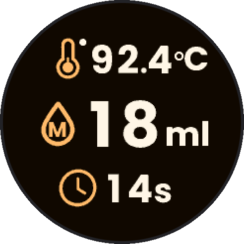<br><b>MANUAL, running</b><br>In − Out and time</td>
<td align="center">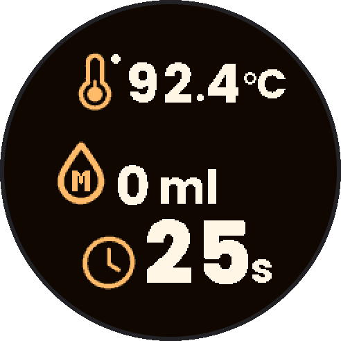<br><b>MANUAL time</b><br>0 = until the second push</td>
</tr>
<tr>
<td align="center">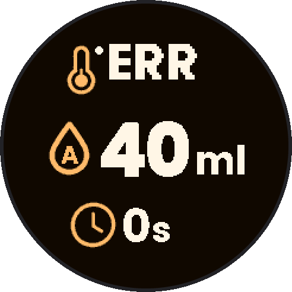<br><b>Probe fault</b><br>ERR, heater off</td>
<td align="center">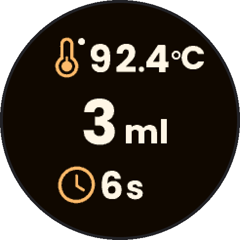<br><b>No water</b><br>the drop blinks (hidden phase)</td>
<td></td>
</tr>
</table>

> These pictures are not mock-ups: they are drawn by the real display code, on a computer
> (see [Tests](#-tests), `./tools/render_screens.sh`).

---

## 🎛 Using the machine

| Action on the encoder | Effect |
|---|---|
| **Turn** | Changes the selected value (not while an extraction runs, except the temperature) |
| **Short push** | Starts the extraction; during the extraction ends it |
| **Double push** (two short pushes in 350 ms) | Validates the edited parameter and selects the next one |
| **Long push** (800 ms) | Switches between **AUTO** and **MANUAL**, or clears the "no water" error |

A short push is reported 350 ms after the release, because the machine waits to see whether a second push
follows.

### Two modes

The mode is shown by the letter in the drop: **A** (AUTO) or **M** (MANUAL). It is saved.

**AUTO**: the machine brews a target volume by itself. Parameters, in the order of the double push:

1. **Volume**: target volume in the cup (ml)
2. **CAL**: weight of the cup (g), only after an extraction, see [calibration](#-cup-volume-and-calibration)
3. **Pre-infusion**: volume sent at the start to wet the puck (ml, 0 = no pre-infusion)
4. **Wait**: soak time after the pre-infusion (s, 0 = no wait)
5. **Flush**: duration of the grouphead rinse after the extraction (s, 0 = no flush)
6. **Temperature**: water setpoint (°C)

**MANUAL**: the pump runs until you push again, or for a set time. Parameters: **volume** (always 0 at
rest, it is not a setting here), **MANUAL time** (s, 0 = until the second push; otherwise the time counts
down to 0 and the extraction stops by itself) and **temperature**. The volume shown is simply In − Out, with
no loss subtracted.

### After an extraction

The final volume and duration stay on the screen for 10 s, then the target values come back. During the last 3 s
they blink (`RESULT_BLINK_WINDOW_MS`, `RESULT_BLINK_MS`) to show that they are about to be replaced. A change of
mode resets them at once. With a flush, the machine waits for a push to start the rinse.

### What is saved, and when

Settings are saved **automatically**, never by hand, and only when something changed (the EEPROM is written
byte by byte, only for the bytes that differ, to spare its life):

- at a double push (the edited parameter is validated),
- at the start of an extraction,
- at a change of mode.

The EEPROM layout is in `src/settings/settings.cpp`.

### Temperature offset

On this coffee machine (Ascaso Steel Uno Pro) the temperature of the boiler probe is higher than the temperature
of the water at the grouphead. The temperature you set and the one shown are the **water**
temperature at the grouphead: the heater regulates the probe at *setpoint + `TEMPERATURE_OFFSET`*
(5 °C by default) and the screen shows *probe − `TEMPERATURE_OFFSET`*. Set `TEMPERATURE_OFFSET` to 0 if your
probe reads the same as the water at the grouphead.

### Standby

After `STANDBY_MINUTES` (30) without activity the heater is switched off. The screen does not change. Any
action on the encoder wakes the machine up, and that first action is ignored. Nothing is saved: after a
reboot the machine is awake.

---

## 🔁 Extraction phases

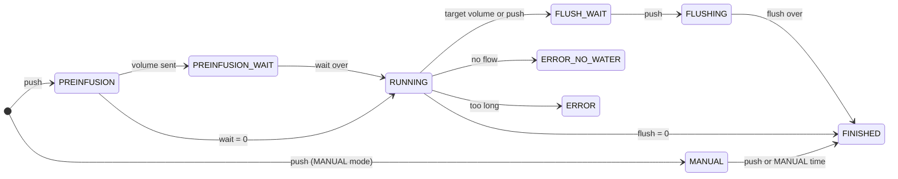

| Phase | Pump | Valve | Ends when |
|---|---|---|---|
| PREINFUSION | on | open | the pre-infusion volume entered the boiler (30 s safety) |
| PREINFUSION_WAIT | off | open | the wait time is over |
| RUNNING | on | open | the cup volume reaches the target, or a push |
| FLUSH_WAIT | off | closed | a push |
| FLUSHING | on | open | the flush time is over (a double push skips it) |
| MANUAL | on | open | a push, or the MANUAL time |

A phase whose setting is 0 is skipped. The valve is opened **before** the pump starts and closed **after**
it stops: the pump never pushes against a closed valve.

---

## ⚖️ Cup volume and calibration

The flow sensors measure the water that enters the boiler (**In**) and the water that returns through the
OPV valve (**Out**). Not everything that stays in the system ends in the cup: the puck retains some, and some
goes to the drip tray when the valve opens at the end (backflush). The sum is the **loss**:

```
volume in the cup = (In − Out) − loss          (never below 0)
```

The extraction stops when this reaches the target volume. The loss starts at 30 ml and is a **setting** that
the machine corrects by itself:

1. brew in AUTO, and weigh the cup (1 g = 1 ml),
2. a double push goes to **CAL**: turn to enter the real weight,
3. a double push validates, and goes back to the volume (the rest of the cycle is skipped).

```
new loss = loss + 0.5 × (measured loss − loss)        kept between 0 and 60 ml, saved in the EEPROM
```

CAL is offered only after an AUTO extraction that ended normally and gave at least 10 ml. If you do not
change the value, nothing changes. The constants are `DEFAULT_LOSS_ML`, `LOSS_MAX_ML`, `CALIBRATION_GAIN`
and `CALIBRATION_MIN_ML`.

---

## 🛡 Safeties

| Safety | What it does |
|---|---|
| **No-flow** | If the water entering the boiler (In sensor) does not increase by 2 ml in 5 s while the pump runs, the extraction stops and the drop blinks. A long push clears it |
| **Maximum duration** | An extraction stops with an error after `DURATION_MAX` seconds |
| **Pre-infusion timeout** | The pre-infusion ends after 30 s even if its volume is not reached |
| **Temperature sensor** | MAX31865 fault or implausible value: the heater is off and the screen shows **ERR** |
| **Standby** | Heater off after 30 minutes without activity |
| **Watchdog** | If `loop()` is blocked for 4 s the board resets (pump and valve relays go back to idle) |

> [!NOTE]
> The watchdog needs a bootloader that handles it correctly. On some old Nano bootloaders a watchdog reset
> can lock the board: if yours does, remove `WATCHDOG_TIMEOUT` in `config.h`.

---

## 🔌 Hardware and wiring

| Function | Nano pin |
|---|---|
| Encoder (rotation and push button) | D2 / D3 (interrupts): the CJMCU-111 signals the push on the same two lines Ga / Gb |
| TFT chip select | D10 |
| TFT data / command | D7 |
| TFT reset | D8 |
| TFT backlight | D9 |
| MAX31865 chip select | D6 |
| Pump relay | D4 |
| Heater relay | D5 |
| 3-way valve relay | A2 |
| Flow sensor In | A0 |
| Flow sensor Out | A1 |

The TFT and the MAX31865 share the hardware SPI (SCK D13, MOSI D11, MISO D12), each with its own chip select.
The pins are defined in `src/config.h`.

**Parts:** Arduino Nano, GC9A01 round display, CJMCU-111 encoder, MAX31865 board with a PT100, three relays
(pump, heater, valve), two flow sensors (In and Out / OPV return).

### Flow sensors and the simulator

The calibration factors, in pulses per millilitre, are `FLOW_K_FACTOR_IN` (12.56) and `FLOW_K_FACTOR_OUT`
(50.0).

> [!IMPORTANT]
> `config.h` contains `#define FLOW_SIMULATOR`. While it is active, **no real sensor is read**: a simulator
> follows the pump relay and produces 3 ml/s with 10 % returning through the OPV. It lets you test the
> machine without the flow sensors. **Comment this line out to use the real sensors.**

---

## ⚙️ Configuration

Every pin, limit, timing and tuning constant is in `src/config.h`, with comments. The main ones:

| Constant | Default | Meaning |
|---|---|---|
| `LONG_PUSH_MS` / `DOUBLE_PUSH_MS` | 800 / 350 | Push detection times |
| `DEFAULT_TEMPERATURE` | 93 | Water temperature, °C |
| `TEMPERATURE_OFFSET` | 5 | The probe is hotter than the water at the grouphead of this machine, °C |
| `DEFAULT_VOLUME` | 40 | Target volume, ml (`VOLUME_MAX` 99) |
| `DEFAULT_PREINFUSION_ML` / `_WAIT_SECONDS` / `DEFAULT_FLUSH_SECONDS` | 10 / 5 / 5 | AUTO defaults (`WAIT` and `FLUSH` are limited to 9: one digit next to their tag) |
| `DEFAULT_LOSS_ML` | 30 | Water that does not end in the cup |
| `PID_KP` / `PID_KI` / `PID_KD` | 40 / 0.1 / 500 | PID gains, over a 1 s window |
| `STANDBY_MINUTES` | 30 | 0 = no standby |
| `NO_FLOW_TIMEOUT_MS` / `NO_FLOW_MIN_ML` | 5000 / 2 | No-flow safety |
| `WATCHDOG_TIMEOUT` | `WDTO_4S` | Remove to disable the watchdog |
| `FLOW_SIMULATOR` | defined | Comment out with real flow sensors |

---

## 🔨 Build and upload

With PlatformIO (board Arduino Nano, ATmega328P, environment `nanoatmega328new`):

```
pio run -e nanoatmega328new
pio run -e nanoatmega328new -t upload
```

The project follows the Arduino sketch layout (`coffee_screen.ino` and the `src/` folder). Libraries:
Adafruit GFX and Adafruit GC9A01A (display), PID_v1 (heater). The EEPROM, SPI and avr/wdt libraries come
with the Arduino core.

The program is close to the 30720 bytes of flash of the Nano. Add this line to the environment of your
`platformio.ini`: it makes the code about 1 KB smaller (shared function prologues, a little slower) and is
needed for the display code to fit:

```
build_flags = -mcall-prologues
```

Serial debug traces are switched on by uncommenting `#define SERIAL_DEBUG` in `src/debug.h` (115200 baud);
they are removed from the build otherwise.

> [!TIP]
> **Memory.** The ATmega328P has 32 KB of flash (30 720 bytes usable with the bootloader) and 2 KB of RAM.
> At the last measured build the flash was at **99.0 %** (30 406 bytes) and RAM at 21.6 %. The margin is
> small: check the size after every change, and prefer `uint8_t` / `int16_t` types and `F()` for constant
> strings. The branch `phase-table` drives the phases from a table and brings the flash down to 97.6 %.

---

## 🧪 Tests

The logic (state machine, settings, screen controller, machine, encoder, temperature, volume) is tested on a
computer, with no Arduino:

```
./test/run.sh
```

It compiles every `test/test_*.cpp` with `g++`, with stubs of the Arduino libraries in `test/stubs` and a
mock of the flow sensor in `test/mock`. The `test_sim_*` tests use the real flow simulator. A GitHub Action
runs the tests and a `cppcheck` static analysis on every push (`.github/workflows/test.yml`).

**Screen pictures.** `./tools/render_screens.sh` draws every screen with the real display code into a frame
buffer and writes the PNG files of `docs/images` (needs `g++` and Python with Pillow). Run it again after a
change of the display code.

---

## 🧱 Code architecture

```
coffee_screen.ino          setup / loop, watchdog
src/
  config.h                 pins, limits, timings, tuning constants
  debug.h                  serial traces
  machine/
    coffee_machine         the application: owns every module, handles the encoder actions
    extraction_controller  extraction state machine, pump / valve relays, safeties, cup volume
  heating/
    temperature_sensor     MAX31865 reading, validity, filter, PT100 polynomial
    heater_controller      PID + feedforward on the flow, heater relay
  settings/
    settings               saved values (EEPROM)
  display/
    screen_controller      what is shown and when it is redrawn (dirty flags)
    display                drawing on the GC9A01
    icons.h, fonts.h       colours, positions, icons, reduced fonts
  lib/
    CJMCU111               rotary encoder + push button (short, double, long push)
    USN_FlowSensor         flow sensors (pin change interrupt)
    FlowSimulator.h        replaces the flow sensors when FLOW_SIMULATOR is defined
    flow_sensor.h          FlowSensor = the real sensor or the simulator
test/                      host tests (stubs, mocks)
tools/                     picture generator for this README
docs/images/               the screen pictures
```

The main loop is cooperative: no RTOS and no `delay()`. Each pass calls `CoffeeMachine::update()`, which
polls the encoder, runs the extraction, reads the temperature, drives the heater and redraws what changed.
The modules do not know each other: `CoffeeMachine` connects them, and the heater and the extraction
receive their inputs as parameters.

---

## 🙏 Credits

- The encoder driver is based on the [CJMCU-111 rotary button demo](https://github.com/ChrisPHL/CJMCU-111-rotary-button-demo)
  by Christian Pohl (push start time, push duration and short / double / long push events were added).
- Ideas from similar open source projects: Gaggiuino, CleverCoffee, espgaggia.
