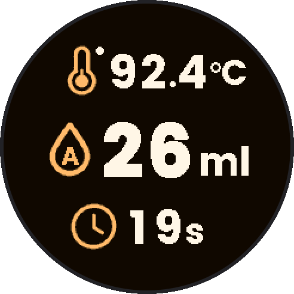
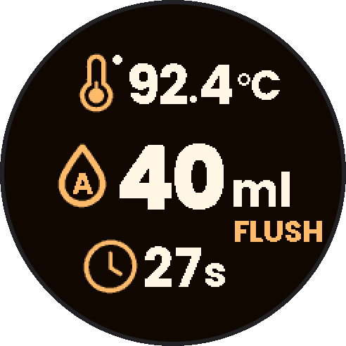
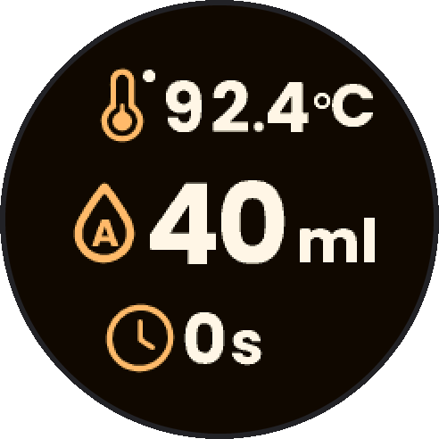
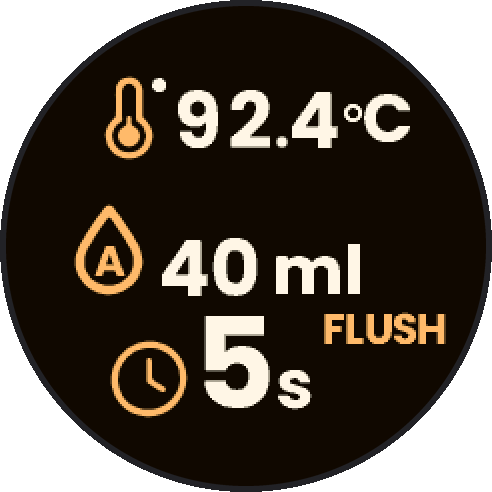
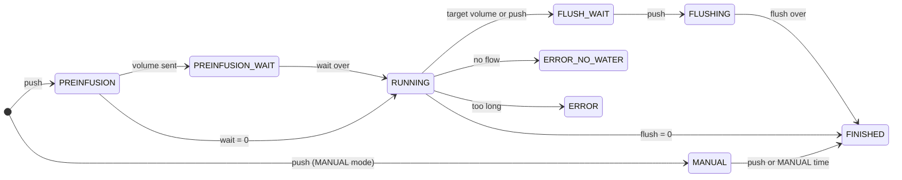

<div align="center">

# ☕ coffee_screen

**A controller for an espresso machine on an Arduino Nano, built and used on an Ascaso Steel Uno Pro.**

A round colour screen, one rotary encoder, a PID-controlled boiler, a pump, a 3-way valve and two flow
sensors that measure the volume in the cup. Everything is done with a single knob: turn to change a value,
push to brew.





-00979D)


[Screens](#-the-screens) · [Using it](#-using-the-machine) · [Extraction](#-extraction-phases) ·
[Calibration](#-cup-volume-and-calibration) · [Safeties](#-safeties) · [Hardware](#-hardware-and-wiring) ·
[Configuration](#-configuration) · [Build](#-build-and-upload) · [Tests](#-tests) ·
[Architecture](#-code-architecture)

</div>

| | |
|---|---|
| **Machine** | Ascaso Steel Uno Pro (the one this project is built and used on) |
| **Screen** | GC9A01 round display, 240 x 240 |
| **Input** | CJMCU-111 rotary encoder with push button |
| **Temperature** | MAX31865 amplifier + PT100 probe, PID with feedforward on the water flow |
| **Brewing** | pump relay, 3-way valve relay, flow sensors "In" (A1) and "Out" (A2, OPV return) |
| **Settings** | saved automatically in the EEPROM |

> [!WARNING]
> This code is not a substitute for an independent thermal fuse / thermostat on the boiler.
> You work on a mains-powered machine with hot water and pressure: do it at your own risk.

---

## 🖥 The screens

<table>
<tr>
<td align="center"></td>
<td>

### Welcome picture

A steaming cup of coffee on a dark background. It is shown in two cases:

- **at start-up**, for 5 seconds (`WELCOME_MS`) while the probe and the flow sensors start; then the real screen
  appears, complete, at once;
- **in standby**: after 30 minutes without activity (`STANDBY_MINUTES`) the heater is switched off and the picture
  replaces the screen until the next action on the encoder (see [Standby](#standby)).

</td>
</tr>
</table>

The screen shows three values: the **temperature** (°C), the **volume** (ml) and the **duration** (s).
The **drop** carries the mode letter (**A** = AUTO, **M** = MANUAL). The small dot next to the thermometer
is lit while the heater is on. The parameter being edited is shown with **large digits**.

### AUTO: an extraction

<table>
<tr>
<td align="center"><br><b>Ready</b><br>target volume, 0 s</td>
<td align="center"><br><b>Pre-infusion</b><br>ml left to send</td>
<td align="center"><br><b>Wait</b><br>seconds left of the soak</td>
</tr>
<tr>
<td align="center"><br><b>Extraction</b><br>volume in the cup, time</td>
<td align="center"><br><b>Result</b><br>stays 10 s after the extraction or the flush (blinks twice at the end), then the target comes back</td>
<td align="center"><br><b>Flush, waiting</b><br>push to rinse the grouphead</td>
</tr>
<tr>
<td align="center"><br><b>Flushing</b><br>the tag blinks, countdown</td>
<td></td>
<td></td>
</tr>
</table>

### Settings: the double push cycle

<table>
<tr>
<td align="center"><br><b>Volume</b><br>target in the cup</td>
<td align="center"><br><b>CAL</b><br>real weight of the cup</td>
<td align="center"><br><b>PRE</b><br>pre-infusion volume</td>
</tr>
<tr>
<td align="center"><br><b>WAIT</b><br>soak time</td>
<td align="center"><br><b>FLUSH</b><br>rinse time</td>
<td align="center"><br><b>Temperature</b><br>water setpoint</td>
</tr>
</table>

### MANUAL mode and errors

<table>
<tr>
<td align="center"><br><b>MANUAL, ready</b><br>letter M, volume 0</td>
<td align="center"><br><b>MANUAL, running</b><br>In − Out and time</td>
<td align="center"><br><b>MANUAL time</b><br>0 = until the second push</td>
</tr>
<tr>
<td align="center"><br><b>Probe fault</b><br>ERR, heater off</td>
<td align="center"><br><b>No water</b><br>the drop blinks (hidden phase)</td>
<td></td>
</tr>
</table>

> These pictures are not mock-ups: they are drawn by the real display code, on a computer
> (see [Tests](#-tests), `./tools/render_screens.sh`).

---

## 🎛 Using the machine

| Action on the encoder | Effect |
|---|---|
| **Turn** | Changes the selected value (not while an extraction runs, except the temperature) |
| **Short push** | Does nothing for the moment: the start / stop button starts and stops the extraction |
| **Double push** (two short pushes in 350 ms) | Validates the edited parameter and selects the next one |
| **Long push** (800 ms) | Switches between **AUTO** and **MANUAL**, or clears the "no water" error |

A short push is reported 350 ms after the release, because the machine waits to see whether a second push
follows.

### Two modes

The mode is shown by the letter in the drop: **A** (AUTO) or **M** (MANUAL). It is saved.

**AUTO**: the machine brews a target volume by itself. Parameters, in the order of the double push:

1. **Volume**: target volume in the cup (ml)
2. **CAL**: weight of the cup (g), only after an extraction, see [calibration](#-cup-volume-and-calibration)
3. **Pre-infusion**: volume sent at the start to wet the puck (ml, 0 = no pre-infusion)
4. **Wait**: soak time after the pre-infusion (s, 0 = no wait)
5. **Flush**: duration of the grouphead rinse after the extraction (s, 0 = no flush)
6. **Temperature**: water setpoint (°C, up to `TEMPERATURE_MAX` = 150: the steaming temperature, 140-145 °C, can be set by hand)

**MANUAL**: the pump runs until you push again, or for a set time. Parameters: **volume** (always 0 at
rest, it is not a setting here), **MANUAL time** (s, 0 = until the second push; otherwise the time counts
down to 0 and the extraction stops by itself) and **temperature**. The volume shown is simply In − Out, with
no loss subtracted.

### The start / stop button

A second push button, between **A0 and GND** (no resistor: the internal pull-up is used), only starts and stops the extraction
(`START_BUTTON` in `Config.h`; comment it out if there is no button):

- **Nothing is running**: whatever was being set is **kept** (saved, and the temperature is applied), the **volume** is selected
  again and an extraction starts, whichever parameter the screen was on. If it was CAL, the weight being entered is validated first
  (the loss is corrected, as the double push does). It starts in AUTO or MANUAL as the mode says.
- **During an extraction**: it ends it (AUTO: the flush waits; MANUAL: the pump stops); then
  it starts the flush, and the next push stops the flush.
- **After a no-water error** it does nothing (the long push of the encoder clears the error); **in standby** the first push only wakes the
  machine, like any action.
- The push counts when the level has stayed 30 ms (`START_BUTTON_DEBOUNCE_MS`), once, however long it is held; a button held at
  power-up does nothing. The encoder works as before.

### After an extraction

The final volume and duration stay on the screen for 10 s (from the end of the extraction in MANUAL mode or without flush,
from the end of the flush otherwise), then the target values come back. During the last 1.6 s
they blink twice (`RESULT_BLINK_WINDOW_MS`, `RESULT_BLINK_MS`) to show that they are about to be replaced. A change of
mode resets them at once. With a flush, the machine waits for a push to start the rinse.

### What is saved, and when

Settings are saved **automatically**, never by hand, and only when something changed (the EEPROM is written
byte by byte, only for the bytes that differ, to spare its life):

- at a double push (the edited parameter is validated),
- at the start of an extraction,
- at a change of mode.

The EEPROM layout is in `src/settings/Settings.cpp`.

### Temperature offset

On this coffee machine (Ascaso Steel Uno Pro) the temperature of the boiler probe is higher than the temperature
of the water at the grouphead. The temperature you set and the one shown are the **water**
temperature at the grouphead: the heater regulates the probe at *setpoint + `TEMPERATURE_OFFSET`*
(5 °C by default) and the screen shows *probe − `TEMPERATURE_OFFSET`*. Set `TEMPERATURE_OFFSET` to 0 if your
probe reads the same as the water at the grouphead.

### Standby

After `STANDBY_MINUTES` (30) without activity the heater is switched off and the **welcome picture** (see
[The screens](#-the-screens)) replaces the screen (with `WELCOME_MS` 0 there is no picture, and the screen does not change). Any
action on the encoder wakes the machine up, the real screen comes back, and that first action is ignored. Nothing is saved: after a
reboot the machine is awake.

---

## 🔁 Extraction phases



| Phase | Pump | Valve | Ends when |
|---|---|---|---|
| PREINFUSION | on | open | the pre-infusion volume entered the boiler (30 s safety) |
| PREINFUSION_WAIT | off | open | the wait time is over |
| RUNNING | on | open | the cup volume reaches the target, or a push |
| FLUSH_WAIT | off | closed | a push |
| FLUSHING | on | open | the flush time is over (a double push skips it) |
| MANUAL | on | open | a push, or the MANUAL time |

A phase whose setting is 0 is skipped. The valve is opened **before** the pump starts and closed **after**
it stops: the pump never pushes against a closed valve.

---

## ⚖️ Cup volume and calibration

The flow sensors measure the water that enters the boiler (**In**) and the water that returns through the
OPV valve (**Out**). Not everything that stays in the system ends in the cup: the puck retains some, and some
goes to the drip tray when the valve opens at the end (backflush). The sum is the **loss**:

```
volume in the cup = (In − Out) − loss          (never below 0)
```

The extraction stops when this reaches the target volume. The loss starts at 30 ml and is a **setting** that
the machine corrects by itself:

1. brew in AUTO, and weigh the cup (1 g = 1 ml),
2. a double push goes to **CAL**: turn to enter the real weight,
3. a double push validates, and goes back to the volume (the rest of the cycle is skipped).

```
new loss = loss + 0.5 × (measured loss − loss)        kept between 0 and 60 ml, saved in the EEPROM
```

CAL is offered only after an AUTO extraction that ended normally and gave at least 10 ml. If you do not
change the value, nothing changes. The constants are `DEFAULT_LOSS_ML`, `LOSS_MAX_ML`, `CALIBRATION_GAIN`
and `CALIBRATION_MIN_ML`.

### The stop before the target

When the pump stops the water goes on for a moment (the pulses not counted yet, the water in the pipes, the pump slowing
down): measured on 100 ml, **2 to 3 ml more** came after the target. So the machine does not wait for the target:

- the volume is checked on **every pass** of the loop, with the pulses counted so far (not every 250 ms);
- the pump stops when `volume now + delay × flow ≥ target`: the **delay** (seconds of flow, 0.4 s at first) is the time the
  water still takes to stop, and the flow is that of In − Out at that moment (so 2 ml early at 5 ml/s);
- **the delay is learned.** After each extraction that ends in the main phase, the machine keeps measuring for 2 s
  (`STOP_SETTLE_MS`) and compares the water that really came after the stop with what it expected; the delay moves 30 % of the
  way toward the one that would have been right. It is saved in the EEPROM, so the next extractions (and the next days)
  start from it. Nothing is learned from a weak flow (under 2 ml/s), from the pre-infusion, or when the flush starts inside the
  2 s;
- once the 2 s have passed the final volume is brought up to date: the number on the screen is the volume that really
  came, **with** the water of the stop, and so is the one used by CAL.

In practice the final volume converges on the target (±0.3 ml in the tests) after a few extractions. The loss that CAL
learns is now the real one (puck and backflush) and no longer hides the water of the stop: **do a CAL (weigh a cup) after
the update.**

---

## 📏 Calibration of the flow sensors

### The Out sensor against the In sensor (2026-11-19)

**Method.** The Out sensor was wired **in series** with the In one, so that both count the same water. The In sensor is taken as
calibrated (`FLOW_K_FACTOR_IN` 12.56 pulses/ml). A dedicated sketch (the branch `out-calibration`, not the machine firmware)
ran **10 sequences of 100 ml** after a push: valve open, pump on until In had counted 100 ml, pump off, the pulses of both sensors
counted for 2 more seconds (the water still moving), 3 s of pause. The heater and the PID were off, the board was powered by a
power supply (not a PC), and every sequence was saved in the EEPROM and read afterwards over the serial line.

| Sequence | Pulses In | Pulses Out | In (ml) | K_OUT of the sequence |
|---:|---:|---:|---:|---:|
| 1 | 1295 | 7629 | 103.10 | 73.99 |
| 2 | 1294 | 7599 | 103.03 | 73.76 |
| 3 | 1288 | 7607 | 102.55 | 74.18 |
| 4 | 1295 | 7639 | 103.10 | 74.09 |
| 5 | 1285 | 7655 | 102.31 | 74.82 |
| 6 | 1291 | 7814 | 102.79 | **76.02** (left out) |
| 7 | 1287 | 7686 | 102.47 | 75.01 |
| 8 | 1283 | 7559 | 102.15 | 74.00 |
| 9 | 1288 | 7554 | 102.55 | 73.66 |
| 10 | 1291 | 7621 | 102.79 | 74.14 |

**Result.** K_OUT = K_IN × (pulses of Out) ÷ (pulses of In), over the sequences kept (**all but the sixth**, the user's choice: it
is 2.5 % above the others, an air bubble is the likely cause):

```
K_OUT = 12.56 × 68 549 / 11 606 = 74.18 pulses per ml          (with the 10 sequences: 74.37, 0.25 % more)
```

- The nine sequences agree: K from 73.66 to 75.01, standard deviation 0.45 (0.6 %). The Out sensor counts **5.9 pulses for one
  of the In sensor** (the placeholder of the code, 50, was 33 % too low).
- **Applied**: `FLOW_K_FACTOR_OUT` = 74.18 in `Config.h`, and the Out sensor is now read (`FLOW_OUT_SENSOR` on): the volume out is
  measured, no longer estimated.
- The raw data are kept in [`docs/calibration/`](docs/calibration/) (the table in CSV, and what the board printed).
- To do it again (a new sensor, a new pump): the sketch of the branch `out-calibration`, with the sensors in series, gives the
  new coefficient in about 15 minutes.

### The pump keeps going after the stop

In the same series the In sensor counted **1283 to 1295 pulses** for a sequence that was stopped at 100 ml: **102.2 to 103.1 ml**,
that is **2.7 ml more** on average (standard deviation 0.35 ml) at about 5 ml/s. About 0.6 ml of it is the 250 ms between two
readings of the sensors in the old code; the rest is the water that goes on after the pump stops. The machine now stops
before the target and learns the delay itself, see [The stop before the target](#the-stop-before-the-target).

---

## 🛡 Safeties

| Safety | What it does |
|---|---|
| **No-flow** | If the water entering the boiler (In sensor) does not increase by 2 ml in 5 s while the pump runs, the extraction stops and the drop blinks. A long push clears it |
| **Maximum duration** | An extraction stops with an error after `DURATION_MAX` seconds (120 by default) |
| **Pre-infusion timeout** | The pre-infusion ends after 30 s even if its volume is not reached |
| **Temperature sensor** | MAX31865 fault or implausible value, `SENSOR_FAULT_TOLERANCE` (3) readings in a row (0.75 s): the heater is off and the screen shows **ERR**. One or two stray readings are ignored |
| **Standby** | Heater off after 30 minutes without activity, the welcome picture is shown |
| **Watchdog** | If `loop()` is blocked for 4 s the board resets (pump and valve relays go back to idle) |

> [!NOTE]
> The watchdog needs a bootloader that handles it correctly. On some old Nano bootloaders a watchdog reset
> can lock the board: if yours does, remove `WATCHDOG_TIMEOUT` in `Config.h`.

> [!TIP]
> **Relay inputs.** The relays are driven active HIGH. After a reset (the watchdog's included) the pins of the
> Nano are floating inputs until `setup()` runs again, and a floating input can switch a relay on. Wire a
> 10 kΩ pull-down resistor between each relay input (pump, valve, heater) and GND: the relays then stay off
> while the pin is not driven. Some relay modules already have one: check yours.

---

## 🔌 Hardware and wiring

| Function | Nano pin |
|---|---|
| Encoder (rotation and push button) | D2 / D3 (interrupts): the CJMCU-111 signals the push on the same two lines Ga / Gb |
| TFT chip select | D10 |
| TFT data / command | D7 |
| TFT reset | D8 |
| TFT backlight | D9 |
| MAX31865 chip select | D6 |
| Start / stop button (optional) | A0, between A0 and GND (the internal pull-up is used: no resistor) |
| Pump relay | D4 |
| Heater relay | D5 |
| 3-way valve relay | A3 |
| Flow sensor In | A1 |
| Flow sensor Out | A2 |

The TFT and the MAX31865 share the hardware SPI (SCK D13, MOSI D11, MISO D12), each with its own chip select.
The pins are defined in `src/Config.h`.

**Boards:** the same wiring and the same code work on the **Arduino Nano R3** (ATmega328P, the board this was
developed on) and on the **Arduino Nano R4** (RA4M1, 5 V I/O like the R3). The only thing the R4 does not have is the
pin change interrupt: the flow sensors need an external interrupt channel, and A0 has none. That is why the flow
sensors are on A1 (In) and A2 (Out): A1 and A2 are interrupt channels 6 and 7 of the R4 (checked in the pin table of its
core); the valve relay is on A3 (a plain output) and A0 is not used. The encoder (D2, D3) is on channels 0 and 1; keep A4
free (it shares channel 1 with D3) and A5 (channel 2, shared with A3).
A GPIO of the R4 gives 8 mA at most (the R3: 40 mA): check the current of the display backlight (D9) and of the relay
inputs, and use a transistor if they need more.

**Parts:** Arduino Nano R3 or R4, GC9A01 round display, CJMCU-111 encoder, MAX31865 board with a PT100, three relays
(pump, heater, valve), two flow sensors (In and Out / OPV return).

> [!IMPORTANT]
> **Power supply.** Do not power the board and the relay board from the USB port of a PC once everything is connected: the
> screen (and its backlight) and three relays together ask more than a USB port gives. Seen on the bench: the firmware
> drove the pump output correctly, but the pump relay did not pull in while the valve one did, until a more powerful
> 5 V supply was used. Use a real 5 V supply (or the supply of the machine) for the relay board and the Nano; a PC
> on USB is fine to upload the firmware and to watch the serial traces only with the relays disconnected.

### Pump and valve

> [!IMPORTANT]
> Two options in `Config.h`. `DRIVE_PUMP` (on): the pump relay follows the phases of the extraction. Commented out, the pump
> stays off and no extraction can be started (a push does nothing when the machine is idle), the **boiler being controlled
> as usual** (PID, the standby, the temperature screen). `DRIVE_VALVE` (on): the 3-way valve relay is driven.
> Commented out, the valve output stays off: the valve is operated by hand, and the extraction (pre-infusion, flush, MANUAL
> mode) runs with the pump only. Comment out `DRIVE_VALVE` if the valve is operated by hand.

### Flow sensors and the simulator

The calibration factors, in pulses per millilitre, are `FLOW_K_FACTOR_IN` (12.56) and `FLOW_K_FACTOR_OUT` (**74.18**, measured
against In, see [Calibration of the flow sensors](#-calibration-of-the-flow-sensors)).

> [!IMPORTANT]
> The board reads the **In** sensor (A1: the water entering the boiler) and the **Out** sensor (A2: the return of the OPV
> valve), both connected (`#define FLOW_OUT_SENSOR` in `Config.h`). If the Out sensor is not connected, comment that line
> out: A2 is then ignored (a floating input would count false pulses) and the volume out is **estimated** from the volume
> in: `FLOW_OUT_ESTIMATE_RATIO` (0.385) of the water that enters the boiler is taken as returned by the OPV. That is the
> figure of the machine: a 50 ml cup goes with 50 ml returned, so with the 30 ml loss 130 ml enter the boiler. The CAL
> calibration absorbs the rest.
>
> `// #define FLOW_SIMULATOR` replaces both sensors by a simulator (3 ml/s while the pump runs, 10 % returning through the
> OPV): uncomment it to test the machine without any flow sensor. It is commented out by default.

---

## ⚙️ Configuration

Every pin, limit, timing and tuning constant is in `src/Config.h`, with comments. The main ones:

| Constant | Default | Meaning |
|---|---|---|
| `LONG_PUSH_MS` / `DOUBLE_PUSH_MS` | 800 / 350 | Push detection times |
| `DEFAULT_TEMPERATURE` / `TEMPERATURE_MAX` | 93 / 150 | Water temperature, °C (150: the steaming temperature can be set by hand) |
| `TEMPERATURE_OFFSET` | 5 | The probe is hotter than the water at the grouphead of this machine, °C |
| `DEFAULT_VOLUME` | 40 | Target volume, ml (`VOLUME_MAX` 99) |
| `DEFAULT_PREINFUSION_ML` / `_WAIT_SECONDS` / `DEFAULT_FLUSH_SECONDS` | 10 / 5 / 5 | AUTO defaults (`WAIT` and `FLUSH` are limited to 9: one digit next to their tag) |
| `DEFAULT_LOSS_ML` | 30 | Water that does not end in the cup |
| `PID_KP` / `PID_KI` / `PID_KD` | 40 / 0.3 / 500 | PID gains, over a 1 s window |
| `STANDBY_MINUTES` | 30 | 0 = no standby |
| `WELCOME_MS` | 5000 | The welcome picture stays this long at start-up, ms (0 = no picture, at start-up nor in standby: about 1.2 KB of flash back, 40 bytes more than master then) |
| `NO_FLOW_TIMEOUT_MS` / `NO_FLOW_MIN_ML` | 5000 / 2 | No-flow safety |
| `DURATION_MAX` | 120 | An extraction stops with an error after this many seconds |
| `SENSOR_FAULT_TOLERANCE` | 3 | Faulty probe readings in a row before ERR and heater off |
| `WATCHDOG_TIMEOUT` | `WDTO_4S` | Remove to disable the watchdog |
| `DRIVE_PUMP` | on | The pump relay is driven and extractions can start (commented out: the boiler only) |
| `DRIVE_VALVE` | on | The 3-way valve relay is driven (commented out: the valve is operated by hand) |
| `START_BUTTON` / `PIN_START_BUTTON` | on / A0 | The start / stop button (between the pin and GND); `START_BUTTON_DEBOUNCE_MS` 30 |
| `FLOW_OUT_SENSOR` | on | The Out flow sensor is connected (A2) and read; comment out if it is not: the Out volume is then In * `FLOW_OUT_ESTIMATE_RATIO` |
| `FLOW_K_FACTOR_IN` / `FLOW_K_FACTOR_OUT` | 12.56 / 74.18 | Pulses per ml of the two flow sensors (Out calibrated against In on 2026-11-19) |
| `STOP_DELAY_DEFAULT_S` / `STOP_DELAY_MAX_S` / `STOP_DELAY_GAIN` | 0.40 / 1.5 / 0.30 | Stop before the target: first delay, its limit, and how fast it is learned (seconds of flow, see "Cup volume") |
| `STOP_SETTLE_MS` / `STOP_ANTICIPATION_MAX_ML` | 2000 / 6 | How long after the stop the water that still comes is measured, and the most the pump stops before the target |
| `FLOW_OUT_ESTIMATE_RATIO` | 0.385 | Out / In without the Out sensor (50 ml cup, 50 ml returned, 30 ml loss) |
| `FLOW_SIMULATOR` | commented out | Uncomment to replace the flow sensors by a simulator |

---

## 🔨 Build and upload

With PlatformIO (board Arduino Nano, ATmega328P, environment `nanoatmega328new`):

```
pio run -e nanoatmega328new
pio run -e nanoatmega328new -t upload
```

For the **Nano R4** use the other environment (PlatformIO downloads its platform at the first build):

```
pio run -e nano_r4
pio run -e nano_r4 -t upload
```

It builds from the same sources. What differs between the boards is in `src/platform/` (`Platform.h`, implemented by
`PlatformAvr.cpp` and `PlatformRenesas.cpp`, one of them empty on each board): the interrupt that counts the pulses of the
flow sensors (pin change interrupt on the R3, `attachInterrupt` on the R4) and the watchdog (`WATCHDOG_MS` in `Config.h` for the R4). The R4 has 256 KB of flash and 32 KB of RAM (the firmware uses about 67 KB and 3.7 KB), so the size
flags below are for the R3 only. `src/platform/nano_r4/wiring_private.h` is an empty header that the display library needs
and the R4 core lacks. **The R4 build compiles in the CI but has not been run on a board yet** (display, encoder, flow
interrupts, watchdog, EEPROM to check).

The project follows the Arduino sketch layout (`coffee_screen.ino` and the `src/` folder). Libraries:
Adafruit GFX and Adafruit GC9A01A (display), PID_v1 (heater). The EEPROM, SPI and avr/wdt libraries come
with the Arduino core.

The PlatformIO project is the folder of the repository (`platformio.ini` is in it; run `pio` from there).

The program is close to the 30720 bytes of flash of the Nano, so `platformio.ini` sets build flags that make the
code smaller: `-mcall-prologues` (about 1 KB, shared function prologues, a little slower, needed for the display
code to fit) and `-fno-ipa-cp -mstrict-X -fno-gcse -fshort-enums` (about 1.3 KB more). The extra script
`tools/link_flags.py` also gives the link step `-ffunction-sections -fdata-sections` (the build is LTO: without them the linker
keeps the functions nobody calls, about 0.5 KB), and every text of the screen is drawn by the firmware itself
(`putText()` in `Display.cpp`), which keeps the text engine of Adafruit_GFX and its default font out of the program (about 2.6 KB).
If you build with another project file, copy these `build_flags` and the script.

Serial debug traces are switched on by uncommenting `#define SERIAL_DEBUG` in `src/Debug.h` (115200 baud);
they are removed from the build otherwise.

**Flow monitor (diagnostic build).** To look at the two flow sensors with the boiler off (checking a wiring, a calibration):

```
pio run -e flow_monitor -t upload
```

It is the machine with two differences (`FLOW_MONITOR`, defined by that environment only; the normal build is unchanged): the
**heater output stays low and the PID does not run** (no heating at all, the probe is still read), and the screen shows the
water counted by the **In** sensor in the **volume** field and the water counted by the **Out** sensor in the **temperature**
field, in millilitres since the start of the extraction (they stay after its end; the temperature field keeps its unit, read it as
ml; the duration field still shows the time). Extractions, pump, valve and safeties work as usual: start one with a push.

> [!TIP]
> **Memory.** The ATmega328P has 32 KB of flash (30 720 bytes usable with the bootloader) and 2 KB of RAM.
> At the last measured build the flash was at **91.8 %** (28 198 bytes, 490 bytes of RAM) as configured: the pump and the
> valve driven, the In and Out flow sensors, the stop before the target (the welcome picture costs about 1.2 KB with its use in
> the standby: `WELCOME_MS` 0 gives them back). About 2.5 KB are left: check the size after every change, and prefer `uint8_t` / `int16_t` types and `F()` for constant
> strings. `./tools/check_flash.sh` builds the firmware, shows its size and fails over the budget of 1 600 bytes of RAM
> (the CI runs it on every push). The flash has no budget: the linker already refuses a program over 30 720 bytes
> (`FLASH_BUDGET=<bytes>` gives an earlier alarm if you want one).

---

## 🧪 Tests

The logic (state machine, settings, screen controller, machine, encoder, temperature, volume) is tested on a
computer, with no Arduino:

```
./test/run.sh
```

It compiles every `test/test_*.cpp` with `g++`, with stubs of the Arduino libraries in `test/stubs` and a
mock of the flow sensor in `test/mock`. The Arduino API that all the tests share (clock, pins, `Serial`, `SPI`,
`EEPROM`) is in `test/stubs/ArduinoStubs.cpp`, and `test/stubs/TestSupport.h` gives them `CHECK`. The
`test_sim_*` tests use the real flow simulator.

**Continuous integration** (`.github/workflows/test.yml`), on every push: the tests, a `cppcheck` static
analysis, and the build of the firmware for the Nano with the flow simulator and with the real flow sensors,
which shows the flash size and fails over the RAM budget (`./tools/check_flash.sh`).

**Screen pictures.** `./tools/render_screens.sh` draws every screen with the real display code into a frame
buffer and writes the PNG files of `docs/images` (needs `g++` and Python with Pillow). Run it again after a
change of the display code.

---

## 🧱 Code architecture

```
coffee_screen.ino          setup / loop, watchdog
platformio.ini             the PlatformIO project: board, libraries, build flags that make the firmware fit
src/
  Config.h                 pins, limits, timings, tuning constants
  Debug.h                  serial traces
  coffee/
    CoffeeMachine          the application: owns every module, handles the encoder actions
    ExtractionController   extraction state machine, pump / valve relays, safeties, cup volume
  heating/
    TemperatureSensor      MAX31865 reading, validity, filter, PT100 polynomial
    HeaterController       PID + feedforward on the flow, heater relay
  settings/
    Settings               saved values (EEPROM)
  display/
    ScreenController       what is shown and when it is redrawn (dirty flags)
    Display                drawing on the GC9A01
    Layout.h, Fonts.h      colours, sizes and positions; the reduced fonts
    IconsData.h            the icons and the welcome picture, compressed (generated from tools/icons_raw.h)
  drivers/
    CJMCU111               rotary encoder + push button (short, double, long push)
    USN_FlowSensor         flow sensors (pin change interrupt)
    FlowSimulator.h        replaces the flow sensors when FLOW_SIMULATOR is defined
    FlowSensor.h           FlowSensor = the real sensor or the simulator
test/                      host tests (run.sh, stubs, mocks)
tools/                     screen pictures (render_screens), icons (compress_icons, png_to_icon.ps1), size and RAM budget (check_flash)
docs/images/               the screen pictures
.github/workflows/         continuous integration: tests, cppcheck, firmware build
```

The main loop is cooperative: no RTOS and no `delay()`. Each pass calls `CoffeeMachine::update()`, which
polls the encoder, runs the extraction, reads the temperature, drives the heater and redraws what changed.
The modules do not know each other: `CoffeeMachine` connects them, and the heater and the extraction
receive their inputs as parameters.

**Conventions.** Identifiers and comments are in English. A source file has the name of the class it holds
(`CoffeeMachine.cpp`), the data members of a class end with `_` (`pumpPin_`), and the tests, tools and
scripts are in snake_case.

---

## 🙏 Credits

- The encoder driver is based on the [CJMCU-111 rotary button demo](https://github.com/ChrisPHL/CJMCU-111-rotary-button-demo)
  by Christian Pohl (push start time, push duration and short / double / long push events were added).
- Ideas from similar open source projects: Gaggiuino, CleverCoffee, espgaggia.
