<div align="center">

# ☕ coffee_screen: documentation

*The full description of the behaviour, the wiring, the configuration and the code. The presentation of the project is in the
[README](../README.md).*

**A controller for an espresso machine on an Arduino Nano R4, built and used on an Ascaso Steel Uno Pro.** (The Nano R3 version is on the `r3` branch, no longer developed.)

A round colour screen, one rotary encoder, a PID-controlled boiler, a pump, a 3-way valve and two flow
sensors that measure the volume in the cup. Everything is done with a single knob: turn to change a value,
push to brew.

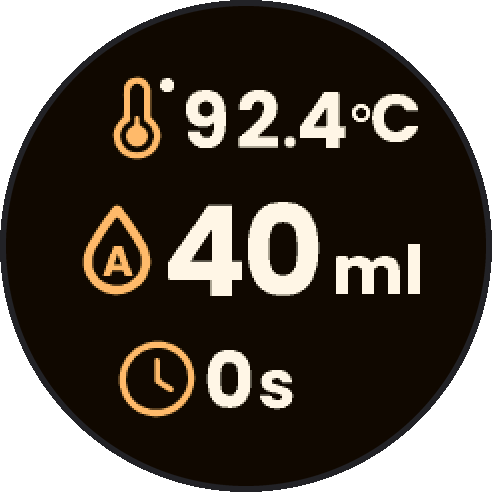
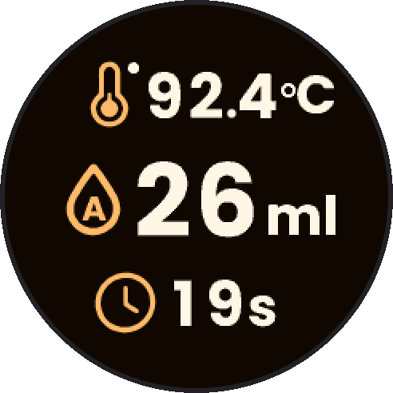
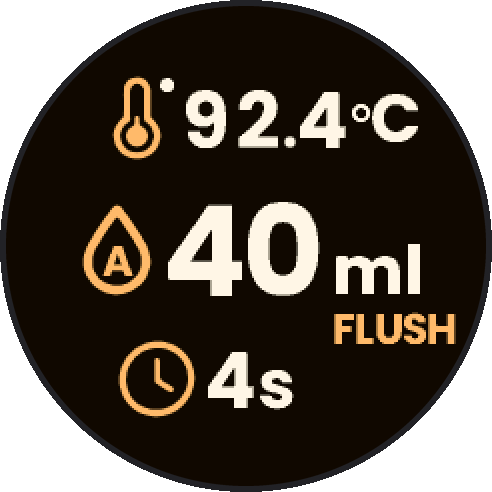


[Screens](#-the-screens) · [Using it](#-using-the-machine) · [Extraction](#-extraction-phases) ·
[Calibration](#-cup-volume-and-calibration) · [Safeties](#-safeties) · [Hardware](#-hardware-and-wiring) ·
[Configuration](#-configuration) · [Build](#-build-and-upload) · [Tests](#-tests) ·
[Architecture](#-code-architecture)

</div>

| | |
|---|---|
| **Machine** | Ascaso Steel Uno Pro (the one this project is built and used on) |
| **Screen** | GC9A01 round display, 240 x 240 |
| **Input** | CJMCU-111 rotary encoder with push button |
| **Temperature** | MAX31865 amplifier + PT100 probe, PID with feedforward on the water flow |
| **Brewing** | pump relay, 3-way valve relay, flow sensors "In" (A1) and "Out" (A2, OPV return) |
| **Settings** | saved automatically in the EEPROM |

> [!WARNING]
> This code is not a substitute for an independent thermal fuse / thermostat on the boiler.
> You work on a mains-powered machine with hot water and pressure: do it at your own risk.

---

## 🖥 The screens

<table>
<tr>
<td align="center"></td>
<td>

### Welcome picture

A steaming cup of coffee on a dark background. It is shown in two cases:

- **at start-up**, for 2 seconds (`WELCOME_MS`) while the probe and the flow sensors start; then the real screen
  appears, complete, at once;
- **in standby**: after 30 minutes without activity (`STANDBY_MINUTES`) the heater is switched off and the picture
  replaces the screen until the next action on the encoder (see [Standby](#standby)).

</td>
</tr>
</table>

The screen shows three values: the **temperature** (°C), the **volume** (ml) and the **duration** (s).
The **drop** carries the mode letter (**A** = AUTO, **M** = MANUAL). The small dot next to the thermometer
is lit while the heater is on. The parameter being edited is shown with **large digits**.

### AUTO: an extraction

<table>
<tr>
<td align="center"><br><b>Ready</b><br>target volume, 0 s</td>
<td align="center">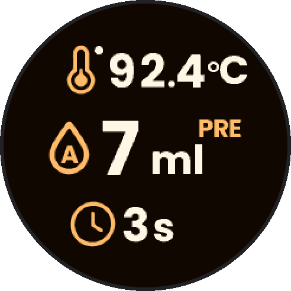<br><b>Pre-infusion</b><br>ml left to send</td>
<td align="center">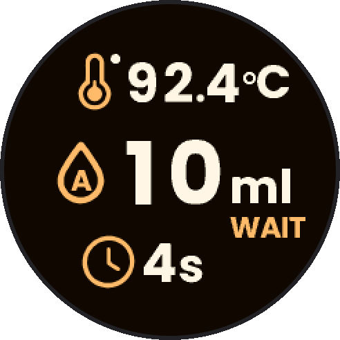<br><b>Wait</b><br>seconds left of the soak</td>
</tr>
<tr>
<td align="center"><br><b>Extraction</b><br>volume in the cup, time</td>
<td align="center">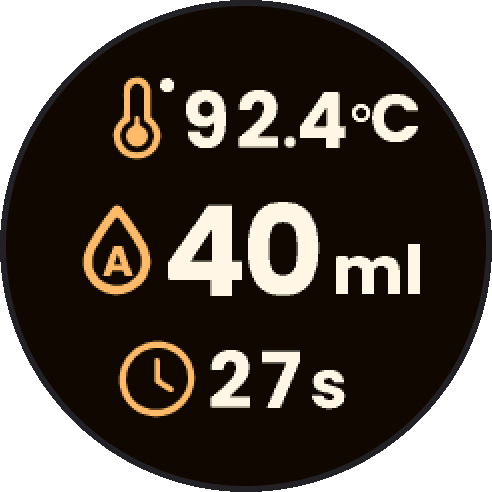<br><b>Result</b><br>stays 10 s after the extraction or the flush, then the target comes back</td>
<td align="center">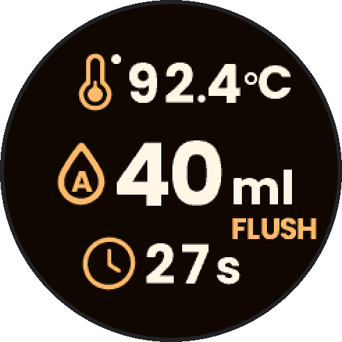<br><b>Flush, waiting</b><br>push to rinse the grouphead</td>
</tr>
<tr>
<td align="center"><br><b>Flushing</b><br>the tag blinks, countdown</td>
<td></td>
<td></td>
</tr>
</table>

### Settings: the double push cycle

<table>
<tr>
<td align="center">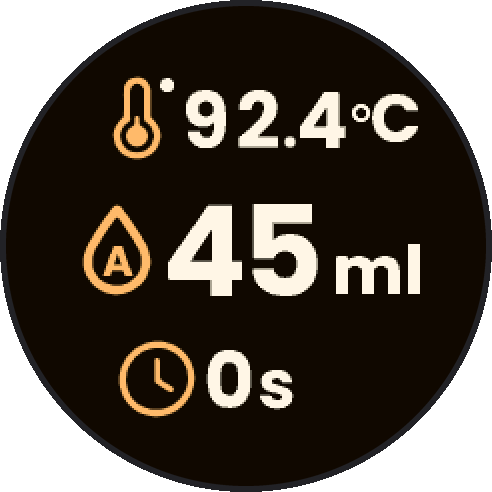<br><b>Volume</b><br>target in the cup</td>
<td align="center">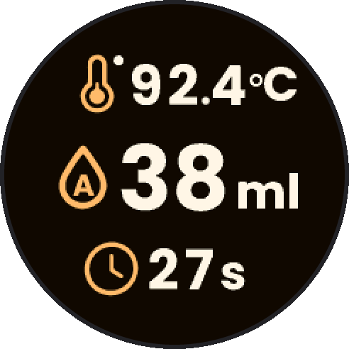<br><b>CAL</b><br>real weight of the cup</td>
<td align="center"><br><b>PRE</b><br>pre-infusion volume</td>
</tr>
<tr>
<td align="center">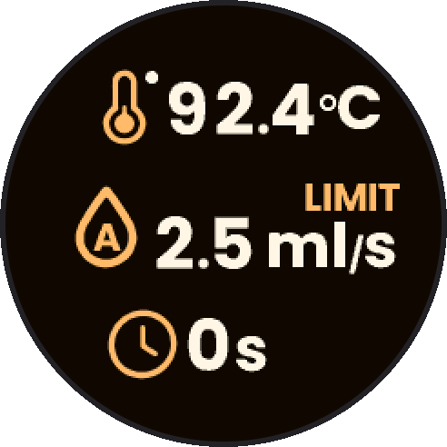<br><b>LIMIT</b><br>flow limit of the extraction</td>
<td align="center">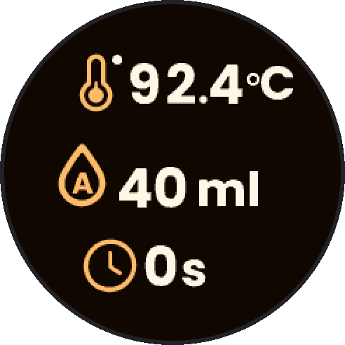<br><b>WAIT</b><br>soak time</td>
<td align="center">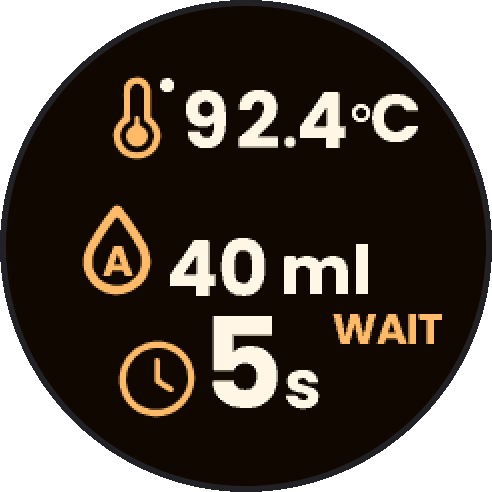<br><b>FLUSH</b><br>rinse time</td>
</tr>
<tr>
<td align="center">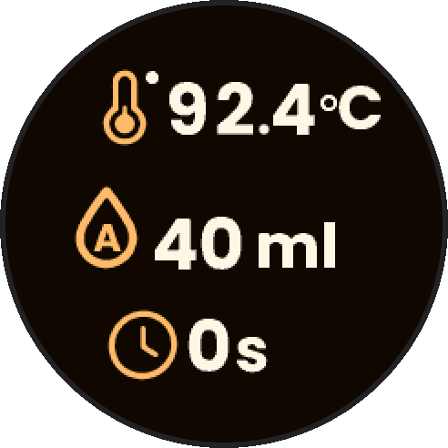<br><b>Temperature</b><br>water setpoint</td>
<td></td>
<td></td>
</tr>
</table>

**LIMIT** (AUTO only, right after PRE) limits the flow of the pump during the main extraction, in ml/s with one decimal: `0.0` means no
limit (the default), then 0.5 to 8.0. It does not apply to the pre-infusion nor to MANUAL. There is no pressure sensor: the flow of the
pump is measured by the In sensor, the flow that one pulse of the mains gives is worked out from it every second or so, and the pump is
given just enough pulses to keep the flow at the limit (one pulse per 20 ms at the most: the SSR switches on the zero crossings). While a
limit applies the stop delay is not learned (see `CLAUDE.md`).

### MANUAL mode and errors

<table>
<tr>
<td align="center">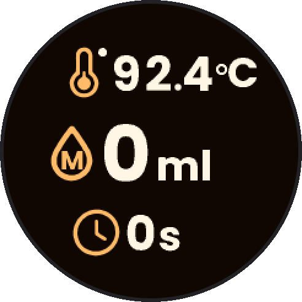<br><b>MANUAL, ready</b><br>letter M, volume 0</td>
<td align="center">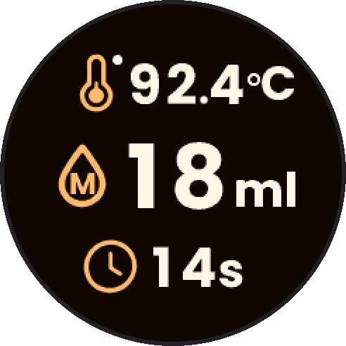<br><b>MANUAL, running</b><br>In − Out and time</td>
<td align="center">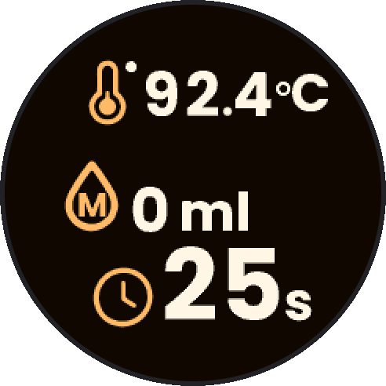<br><b>MANUAL time</b><br>0 = until the second push</td>
</tr>
<tr>
<td align="center">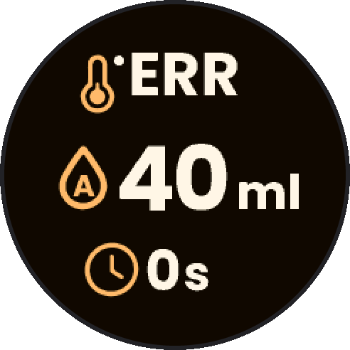<br><b>Probe fault</b><br>ERR, heater off</td>
<td align="center">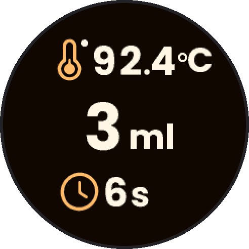<br><b>No water</b><br>the drop blinks (hidden phase)</td>
<td></td>
</tr>
</table>

> These pictures are not mock-ups: they are drawn by the real display code, on a computer
> (see [Tests](#-tests), `./tools/render_screens.sh`).

### Fonts and transitions

All the text of the screen is drawn in **Poppins Bold, anti-aliased**: every glyph is a mask of 4 levels of opacity (2 bits per
pixel), blended with the background, so the edges are smooth on the round screen. The masks are generated by
`tools/generate_fonts.py` into `src/display/Fonts.h` (the font file, SIL Open Font License, is not in the repository).

The screen moves a little when something changes, and never blinks:

- **Seconds**: during an extraction the digits of the duration roll (the old digit leaves upward, the new one comes up from below,
  `ROLL_DURATION_MS` = 260 ms). The volume does not roll: its digits are replaced at once.
- **Change of parameter** (double push): the rows whose look changes (size of the digits, tag, unit) fade out in `FADE_OUT_MS` = 60 ms,
  then the new look fades in in `FADE_IN_MS` = 550 ms, from `FADE_IN_START_PERCENT` = 20 % of the brightness to 100 % (ease-out). Each
  look is drawn at its own size and place: no zoom, the old and the new are never drawn together. When the selection goes to another
  row (temperature, volume, duration), the row that was selected goes back to its normal size at once.
- **Change of mode** (short push): the drop, its letter A / M and the rows that change fade the same way.

A fade is drawn at most every `FADE_FRAME_MS` = 30 ms and the main loop goes on meanwhile (the encoder, the heater and the
safeties are never waiting for the screen). Setting the durations to 0 gives instant changes.

### Icons

The thermometer, the drop and the clock are **16-level** masks (4 bits per pixel, `tools/icons_raw.h`, stored compressed in
`IconsData.h`): their edges are as smooth as the text. The steam and the welcome picture keep their 4 levels.

---

## 🎛 Using the machine

| Action on the encoder | Effect |
|---|---|
| **Turn** | Changes the selected value (not while an extraction runs, except the temperature) |
| **Short push** | Switches between **AUTO** and **MANUAL** (ignored during an extraction), or clears the "no water" error (the only way to clear it). The start / stop button starts and stops the extraction |
| **Double push** (two short pushes in 350 ms) | Validates the edited parameter and selects the next one |
| **Long push** (800 ms) | Enters and leaves the **steaming mode** (nothing going on) |

A short push is reported 350 ms after the release, because the machine waits to see whether a second push
follows.

### Two modes

The mode is shown by the letter in the drop: **A** (AUTO) or **M** (MANUAL). It is saved.

**AUTO**: the machine brews a target volume by itself. Parameters, in the order of the double push:

1. **Volume**: target volume in the cup (ml)
2. **CAL**: weight of the cup (g), only after an extraction, see [calibration](#-cup-volume-and-calibration)
3. **Pre-infusion**: volume sent at the start to wet the puck (ml, 0 = no pre-infusion)
4. **Wait**: soak time after the pre-infusion (s, 0 = no wait)
5. **Flush**: duration of the grouphead rinse after the extraction (s, 0 = no flush)
6. **Temperature**: water setpoint (°C, up to `TEMPERATURE_MAX` = 150: the steaming temperature, 140-145 °C, can be set by hand)

**MANUAL**: the pump runs until you push again, or for a set time. Parameters: **volume** (always 0 at
rest, it is not a setting here), **MANUAL time** (s, 0 = until the second push; otherwise the time counts
down to 0 and the extraction stops by itself) and **temperature**. The volume shown is simply In − Out, with
no loss subtracted.

### The start / stop button

A second push button, between **A0 and GND** (no resistor: the internal pull-up is used), only starts and stops the extraction
(`START_BUTTON` in `Config.h`; comment it out if there is no button):

- **Nothing is running**: whatever was being set is **kept** (saved, and the temperature is applied), the **volume** is selected
  again and an extraction starts, whichever parameter the screen was on. If it was CAL, the weight being entered is validated first
  (the loss is corrected, as the double push does). It starts in AUTO or MANUAL as the mode says.
- **During an extraction**: it ends it (AUTO: the flush waits; MANUAL: the pump stops); then
  it starts the flush, and the next push stops the flush.
- **After a no-water error** it does nothing (the short push of the encoder clears the error); **in standby** the first push only wakes the
  machine, like any action.
- The push counts when the level has stayed 30 ms (`START_BUTTON_DEBOUNCE_MS`), once, however long it is held; a button held at
  power-up does nothing. The encoder works as before.

### Steaming mode

A **long push** of the encoder (800 ms), with nothing going on, enters the steaming mode; another long push leaves it (a long push
during an extraction does nothing). The machine then only regulates the boiler (PID and heater) at the **steaming temperature**
(**SteamingTemp**, 135 °C by default, `DEFAULT_STEAMING_TEMPERATURE`); the temperature of the brewing (**BrewingTemp**) is the one of the
other modes, and both are kept in the EEPROM.

- **No extraction**: the extraction is not updated (no volume is read), the pump and the valve stay off, the start / stop button does
  nothing, and the short and double pushes neither.
- **The screen** shows the temperature alone, in large digits in the middle, with the thermometer icon on its left as in the other modes, three volutes of steam above and the text `STEAM` under, both centered on the screen (no other icon, no volume, no duration, no heater dot); `ERR` if
  the probe fails.
- **The encoder** sets SteamingTemp: the setpoint is shown for 2 s after each turn (`STEAM_SETPOINT_SHOW_MS`), then the measured
  temperature comes back. It is saved at each change and applied to the heater at once.
- **The offset** (`TEMPERATURE_OFFSET`) applies as in the other modes: the probe is regulated at SteamingTemp + offset and the screen shows probe − offset.
- **Leaving it**: the brewing setpoint is applied again, the real screen is drawn again in full with the volume selected. The mode is
  not saved: after a reboot the machine is in brewing mode. The standby works as in the other modes.

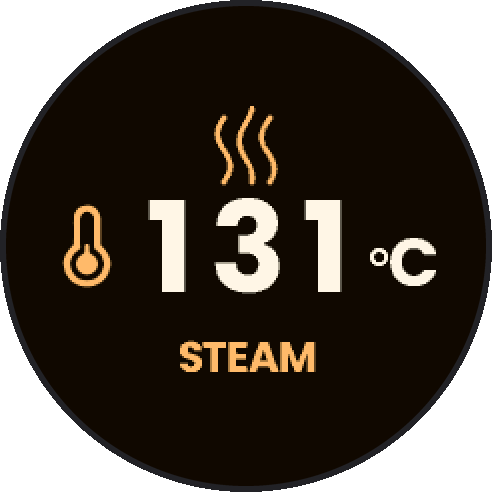

### After an extraction

The final volume and duration stay on the screen for 10 s (from the end of the extraction in MANUAL mode or without flush,
from the end of the flush otherwise), then the target values come back (they do not blink). A change of
mode resets them at once. With a flush, the machine waits for a push to start the rinse.

### The journal of the last extractions

The machine keeps in its EEPROM a **journal of the last 50 AUTO extractions** (a ring: the oldest one is overwritten). The MANUAL
extractions are not kept; an AUTO extraction is, whichever phase it ended in (pre-infusion included). It is there to understand an
extraction that went wrong (a cup of 12 ml instead of 40): how it ended, and what the sensors counted. Nothing in the machine shows
or uses it. One entry is written per extraction, when its values are final (a few seconds after the stop, the water that still
comes is then counted), so a power cut in the middle loses that extraction only.

| Field | Meaning |
|---|---|
| #number | the sequence number of the extraction (it wraps at 256): it gives the order |
| reason | why it ended: `TARGET` (the volume was reached), `USER` (the start / stop button), `NO_WATER` (no-flow safety), `MAX_TIME` (`DURATION_MAX`) |
| phase | in which phase it ended: `PRE` (pre-infusion), `WAIT` or `RUN` (main extraction) |
| tgt, pre, wait | the settings it used: the target volume, the pre-infusion volume and the wait time |
| duration | seconds from the start |
| in, out, net | the water counted by the In and the Out sensor (ml), and In − Out |
| loss, cup | the loss used, and the final volume shown: In − Out − loss |
| cal | the cup weight entered in the CAL parameter and validated (g = ml); written afterwards into the entry of that extraction, only if the weight was changed, otherwise nothing (0 in the EEPROM, not printed) |
| delay | the delay of the stop before the target used (seconds of flow) |
| temperatures | the temperature shown at the start of the extraction and when the entry was written (a few seconds after the end), °C |

**Reading it.** The machine answers the letter `j` on its USB serial line (115200 baud) with the journal, one line per extraction. It
says nothing by itself, and reading writes nothing: nothing has to be flashed. With any serial monitor, type `j` (and Enter):

```
pio device monitor                     # (or any serial monitor, 115200 baud), then type j
```

**The simplest way: double-click `tools/read_journal.bat`** (or open `tools/journal_viewer.html` in Chrome or Edge). The page reads the USB serial
port itself (Web Serial API), sends `j`, and draws the journal: a summary, the water of each extraction, the duration and the temperatures,
the **flow curves** (below), a table, and the text the machine sent. The first time it asks which port is the machine (then it remembers: the next time the journal is read
as soon as the page opens). It closes the port after the answer, so nothing stays blocked; close the serial monitors before. The button
**Example** shows made up extractions without a machine.

The answer of the machine is `JOURNAL`, one line per extraction, the last one first, then `END`:

```
#12 TARGET  ended in RUN  tgt 60 pre 40 wait 5 | 27 s | in 102.3 out 54.1 net 48.2 loss 36.3 cup 12 cal 10 | delay 0.37 | 88 -> 91 C
```

(`cal` only appears when a weight was entered.)

**The flow curves.** For the last 20 AUTO extractions the machine also keeps how the water flowed: every half second (`CURVE_SAMPLE_MS`,
twice the period of the flow sensors) it records the water that went through the In sensor and through the Out sensor during that half
second, in tenths of ml, from the push until the entry is written (the pre-infusion, the wait, the extraction and the water that comes
after the stop; at most `CURVE_SAMPLES` = 180 samples = 90 s: a longer extraction is recorded up to 90 s). They are in the answer of `j`, after the entries, one line per curve
(the number is the one of its entry; the values are tenths of ml per sample):

```
CURVE #12 500 ms 84 | in 0,5,14,20,... | out 0,0,0,2,...
```

The viewer draws one extraction at a time (choose it in the list): the **flow In** and the **flow Out** (ml/s) in one chart, the **volume
that came out** (ml) under it, on the same time axis, with a dashed line where the extraction ended (the stop of the pump), a box with the
values when the mouse is on a chart, and a switch to smooth the flows over 1.5 s (a sample is good to 0.2 ml/s: the pulses of the In
sensor are 0.08 ml each). `tools/journal_view.py` ignores these lines.

The curves are in the EEPROM right after the entries of the journal (the data flash of the R4 holds 8 KB): a ring of 20 slots of 362 bytes
(the number of the entry, the number of samples, the samples). A curve is written by the passes of the main loop that follow the
journal entry, 24 bytes at a time, so that the machine never waits for the flash; the header of its slot is blanked first and written last,
so a power cut leaves no half curve. The samples are kept in RAM during the extraction (480 bytes, `FlowRecorder`).

**A graphical view.** `tools/journal_view.py` turns that text into one HTML page (no dependency, no network, light and dark themes): the water
of each extraction (the volume in the cup, the loss and the Out water, with a tick for the target, and how each one ended: target reached,
button, no water, maximum duration), the duration, the temperatures, and a table. Hover a bar for the details.

```
python tools/journal_view.py dump.txt      # the text printed by the machine, saved from a serial monitor
python tools/journal_view.py --port COM12  # or ask the machine itself (pip install pyserial; close the other serial monitors)
python tools/journal_view.py --demo        # an example with made up extractions
```

It writes `journal.html` (`-o` to change the name); open it in a browser.

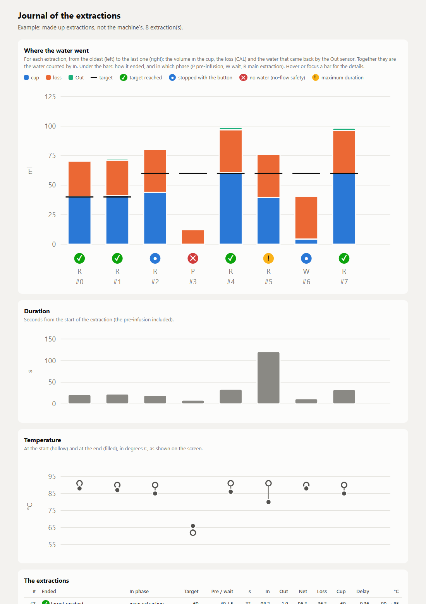

*The picture is the example (made up extractions), not a real machine.*

An entry is 16 bytes (packed: the volumes in tenths of ml, the loss in quarters of ml). The map of the EEPROM (8192 bytes; the layout is in
`src/settings/Journal.h`):

| Addresses | Content |
|---|---|
| 0 .. 21 | the settings (marker, temperature, volume, pre-infusion, wait, flush, mode, MANUAL time, loss, stop delay, steaming temperature, flow limit); 22 and 23 are free |
| 24 | the next slot of the journal |
| 25 .. 824 | the 50 entries of the journal (16 bytes each) |
| 825 | the next slot of the curves |
| 826 .. 8065 | the 20 curves (362 bytes each: the number of the entry, the number of samples, then 180 samples of In and Out at most) |
| 8066 .. 8191 | free (126 bytes) |

After a change of this map, erase the old journal once with `pio run -e journal_clear -t upload` (then flash the machine again): the old
entries and curves would be misread. The EEPROM is written only at the
end of an extraction (16 bytes, and one more byte when CAL is validated; with its curve 380 bytes at most), far from its limit of 100 000
writes per byte (a slot of the curves is written once every 20 extractions).

### What is saved, and when

Settings are saved **automatically**, never by hand, and only when something changed (the EEPROM is written
byte by byte, only for the bytes that differ, to spare its life):

- at a double push (the edited parameter is validated),
- at the start of an extraction,
- at a change of mode,
- at each turn of the encoder in the steaming mode (SteamingTemp),
- at the end of each extraction: its line and its flow curve in the [journal](#the-journal-of-the-last-extractions).

The EEPROM layout is in `src/settings/Settings.cpp`.

### Temperature offset

On this coffee machine (Ascaso Steel Uno Pro) the temperature of the boiler probe is higher than the temperature
of the water at the grouphead. The temperature you set and the one shown are the **water**
temperature at the grouphead: the heater regulates the probe at *setpoint + `TEMPERATURE_OFFSET`*
(5 °C by default) and the screen shows *probe − `TEMPERATURE_OFFSET`*. Set `TEMPERATURE_OFFSET` to 0 if your
probe reads the same as the water at the grouphead.

### Standby

After `STANDBY_MINUTES` (30) without activity the heater is switched off and the **welcome picture** (see
[The screens](#-the-screens)) replaces the screen (with `WELCOME_MS` 0 there is no picture, and the screen does not change). Any
action on the encoder wakes the machine up, the real screen comes back, and that first action is ignored. Nothing is saved: after a
reboot the machine is awake.

---

## 🔁 Extraction phases

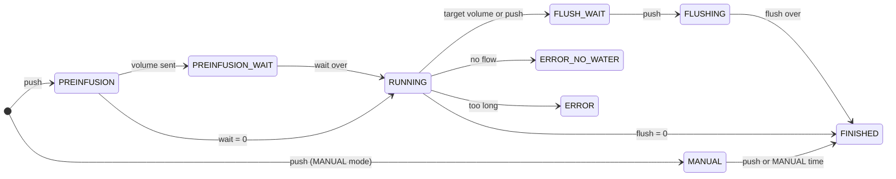

| Phase | Pump | Valve | Ends when |
|---|---|---|---|
| PREINFUSION | on | open | the pre-infusion volume entered the boiler (30 s safety) |
| PREINFUSION_WAIT | off | open | the wait time is over |
| RUNNING | on | open | the cup volume reaches the target, or a push |
| FLUSH_WAIT | off | closed | a push |
| FLUSHING | on | open | the flush time is over (a double push skips it) |
| MANUAL | on | open | a push, or the MANUAL time |

A phase whose setting is 0 is skipped. The valve is opened **before** the pump starts and closed **after**
it stops: the pump never pushes against a closed valve.

---

## ⚖️ Cup volume and calibration

The flow sensors measure the water that enters the boiler (**In**) and the water that returns through the
OPV valve (**Out**). Not everything that stays in the system ends in the cup: the puck retains some, and some
goes to the drip tray when the valve opens at the end (backflush). The sum is the **loss**:

```
volume in the cup = (In − Out) − loss          (never below 0)
```

The extraction stops when this reaches the target volume. The loss starts at 50 ml (`DEFAULT_LOSS_ML`) and is a **setting** that
the machine corrects by itself:

1. brew in AUTO, and weigh the cup (1 g = 1 ml),
2. a double push goes to **CAL**: turn to enter the real weight,
3. a double push validates, and goes back to the volume (the rest of the cycle is skipped).

```
new loss = loss + 0.75 × (measured loss − loss)       kept between 0 and 200 ml, saved in the EEPROM
```

CAL is offered only after an AUTO extraction that ended normally and gave at least 10 ml. If you do not
change the value, nothing changes. The constants are `DEFAULT_LOSS_ML`, `LOSS_MAX_ML`, `CALIBRATION_GAIN`
and `CALIBRATION_MIN_ML`.

### The stop before the target

When the pump stops the water goes on for a moment (the pulses not counted yet, the water in the pipes, the pump slowing
down): measured on 100 ml, **2 to 3 ml more** came after the target. So the machine does not wait for the target:

- the volume is checked on **every pass** of the loop, with the pulses counted so far (not every 250 ms);
- the pump stops when `volume now + delay × flow ≥ target`: the **delay** (seconds of flow, 0.4 s at first) is the time the
  water still takes to stop, and the flow is that of In − Out at that moment (so 2 ml early at 5 ml/s);
- **the delay is learned.** After each extraction that ends in the main phase, the machine keeps measuring for 2 s
  (`STOP_SETTLE_MS`) and compares the water that really came after the stop with what it expected; the delay moves 30 % of the
  way toward the one that would have been right. It is saved in the EEPROM, so the next extractions (and the next days)
  start from it. Nothing is learned from a weak flow (under 2 ml/s), from the pre-infusion, or when the flush starts inside the
  2 s;
- once the 2 s have passed the final volume is brought up to date: the number on the screen is the volume that really
  came, **with** the water of the stop, and so is the one used by CAL.

In practice the final volume converges on the target (±0.3 ml in the tests) after a few extractions. The loss that CAL
learns is now the real one (puck and backflush) and no longer hides the water of the stop: **do a CAL (weigh a cup) after
the update.**

---

## 📏 Calibration of the flow sensors

### The In sensor against a measured volume

The In sensor is the reference of the machine (`FLOW_K_FACTOR_IN` = **12.56 pulses per ml**), and the Out sensor was calibrated
against it (next section). Its factor comes from this series: **25 runs**, each giving the number of pulses the sensor counted (the
interrupt service routine increments a counter at every pulse) and the volume of water that came out, measured at the output of the
machine. The raw data are in [`calibration/in_flow_sensor.csv`](calibration/in_flow_sensor.csv):

| Column | Meaning |
|---|---|
| `run` | number of the run (1 to 25) |
| `pulses_in` | pulses counted by the In sensor during the run (the interrupts) |
| `measured_ml` | volume measured at the output, in millilitres |
| `k_in_of_the_run` | `pulses_in` ÷ `measured_ml`: the factor this run alone would give |

**Result.** The factor is the total number of pulses over the total volume, so that a long run weighs more than a short one:

```
K_IN = 55 681 pulses / 4 435.3 ml = 12.554 pulses per ml      -> 12.56 in Config.h
```

- A run is **2 185 to 2 272 pulses** for **173.5 to 183.1 ml** (about 177 ml on average).
- The factor of each run goes from **12.30 to 12.94** (median 12.54): a standard deviation of **0.17**, that is **1.4 %** from one
  run to the next (the scatter of the measurement of the volume and of the sensor). The total over 25 runs
  smooths it: the error on the factor itself is about 1.4 % ÷ √25 = **0.3 %**.
- The volume the machine shows is `pulses / K_IN`; a factor 1 % too high would show 1 % too little water (0.4 ml on a 40 ml cup).
- To do it again (a new sensor, another pump or tubing): run the pump, note the pulses (`FlowSensor` counts them) and the
  volume measured at the output, compute `pulses / ml` over the total of several runs, and put it in `FLOW_K_FACTOR_IN`.

### The Out sensor against the In sensor (2026-11-19)

**Method.** The Out sensor was wired **in series** with the In one, so that both count the same water. The In sensor is taken as
calibrated (`FLOW_K_FACTOR_IN` 12.56 pulses/ml, see above). A dedicated sketch (the branch `out-calibration`, not the machine firmware)
ran **10 sequences of 100 ml** after a push: valve open, pump on until In had counted 100 ml, pump off, the pulses of both sensors
counted for 2 more seconds (the water still moving), 3 s of pause. The heater and the PID were off, the board was powered by a
power supply (not a PC), and every sequence was saved in the EEPROM and read afterwards over the serial line.

| Sequence | Pulses In | Pulses Out | In (ml) | K_OUT of the sequence |
|---:|---:|---:|---:|---:|
| 1 | 1295 | 7629 | 103.10 | 73.99 |
| 2 | 1294 | 7599 | 103.03 | 73.76 |
| 3 | 1288 | 7607 | 102.55 | 74.18 |
| 4 | 1295 | 7639 | 103.10 | 74.09 |
| 5 | 1285 | 7655 | 102.31 | 74.82 |
| 6 | 1291 | 7814 | 102.79 | **76.02** (left out) |
| 7 | 1287 | 7686 | 102.47 | 75.01 |
| 8 | 1283 | 7559 | 102.15 | 74.00 |
| 9 | 1288 | 7554 | 102.55 | 73.66 |
| 10 | 1291 | 7621 | 102.79 | 74.14 |

**Result.** K_OUT = K_IN × (pulses of Out) ÷ (pulses of In), over the sequences kept (**all but the sixth**, the user's choice: it
is 2.5 % above the others, an air bubble is the likely cause):

```
K_OUT = 12.56 × 68 549 / 11 606 = 74.18 pulses per ml          (with the 10 sequences: 74.37, 0.25 % more)
```

- The nine sequences agree: K from 73.66 to 75.01, standard deviation 0.45 (0.6 %). The Out sensor counts **5.9 pulses for one
  of the In sensor** (the placeholder of the code, 50, was 33 % too low).
- **Applied**: `FLOW_K_FACTOR_OUT` = 74.18 in `Config.h`, and the Out sensor is read: the volume out is measured.
- The raw data are kept in [`docs/calibration/`](calibration/) (the table in CSV, and what the board printed).
- To do it again (a new sensor, a new pump): the sketch of the branch `out-calibration`, with the sensors in series, gives the
  new coefficient in about 15 minutes.

### The pump keeps going after the stop

In the same series the In sensor counted **1283 to 1295 pulses** for a sequence that was stopped at 100 ml: **102.2 to 103.1 ml**,
that is **2.7 ml more** on average (standard deviation 0.35 ml) at about 5 ml/s. About 0.6 ml of it is the 250 ms between two
readings of the sensors in the old code; the rest is the water that goes on after the pump stops. The machine now stops
before the target and learns the delay itself, see [The stop before the target](#the-stop-before-the-target).

---

## 🛡 Safeties

| Safety | What it does |
|---|---|
| **No-flow** | If the water entering the boiler (In sensor) does not increase by 2 ml in 5 s while the pump runs, the extraction stops and the drop blinks. A short push of the encoder clears it (the only way) |
| **Maximum duration** | An extraction stops with an error after `DURATION_MAX` seconds (120 by default) |
| **Pre-infusion timeout** | The pre-infusion ends after 30 s even if its volume is not reached |
| **Temperature sensor** | MAX31865 fault or implausible value, `SENSOR_FAULT_TOLERANCE` (3) readings in a row (0.75 s): the heater is off and the screen shows **ERR**. One or two stray readings are ignored |
| **Standby** | Heater off after 30 minutes without activity, the welcome picture is shown |
| **Watchdog** | If `loop()` is blocked for 4 s the board resets (pump and valve relays go back to idle) |

> [!TIP]
> **Relay inputs.** The relays are driven active HIGH. After a reset (the watchdog's included) the pins of the
> Nano are floating inputs until `setup()` runs again, and a floating input can switch a relay on. Wire a
> 10 kΩ pull-down resistor between each relay input (pump, valve, heater) and GND: the relays then stay off
> while the pin is not driven. Some relay modules already have one: check yours.

---

## 🔌 Hardware and wiring

| Function | Nano pin |
|---|---|
| Encoder (rotation and push button) | D2 / D3 (interrupts): the CJMCU-111 signals the push on the same two lines Ga / Gb |
| TFT chip select | D10 |
| TFT data / command | D7 |
| TFT reset | D8 |
| TFT backlight | D9 |
| MAX31865 chip select | D6 |
| Start / stop button (optional) | A0, between A0 and GND (the internal pull-up is used: no resistor) |
| Pump relay | D4 |
| Heater relay | D5 |
| 3-way valve relay | A3 |
| Flow sensor In | A1 |
| Flow sensor Out | A2 |

The TFT and the MAX31865 share the hardware SPI (SCK D13, MOSI D11, MISO D12), each with its own chip select.
The pins are defined in `src/Config.h`.

**Board:** the **Arduino Nano R4** (RA4M1, 5 V I/O). The flow sensors need an external interrupt channel, and A0 has none. That
is why the flow sensors are on A1 (In) and A2 (Out): A1 and A2 are interrupt channels 6 and 7 of the R4 (checked in the pin table
of its core); the valve relay is on A3 (a plain output) and A0 is not used. The encoder (D2, D3) is on channels 0 and 1; keep A4
free (it shares channel 1 with D3) and A5 (channel 2, shared with A3).
A GPIO of the R4 gives 8 mA at most: check the current of the display backlight (D9) and of the relay inputs, and use a
transistor if they need more. (The Nano R3 version, with the same wiring, is on the `r3` branch.)

**Parts:** Arduino Nano R4, GC9A01 round display, CJMCU-111 encoder, MAX31865 board with a PT100, three relays
(pump, heater, valve; solid state relays in the author's build: a DC-DC one for the pump, an AC one for the heater and one for the
valve), two flow sensors (In and Out / OPV return), a 5 V power supply (2 A).

> [!IMPORTANT]
> **Power supply.** The relays did not always switch on when the screen and the boiler were running (the pump relay stayed off,
> with the firmware driving its output correctly, a test sketch showing it). That was a **lack of power**, not a firmware matter:
> from the 5 V of the Nano (powered by a PC USB port) the input of the pump solid state relay saw only **3.4 V** with the screen
> on, just at its turn-on threshold (about 3 to 3.5 V), and over 4 V without the screen. The fix, confirmed on the machine: the
> screen (and its backlight), the flow sensors and the MAX31865 are fed directly by a **dedicated 5 V supply** (5.15 V measured,
> 2 A), not by the 5 V pin of the Nano. In the final build everything is on that supply, and the USB cable is plugged in only with the
> machine switched off (upload, debug).
>
> - Join the grounds: the GND of the supply, of the Nano, of the screen, the sensors and the relay inputs.
> - Never put the USB 5 V and the 5 V of another supply in parallel: use a USB cable without its 5 V wire to upload, or a Schottky
>   diode (1N5819) in series between the supply and the 5V pin of the Nano.
> - A 100 µF + 100 nF capacitor near the screen helps; check the voltage of a cheap supply (5.0 to 5.3 V) before connecting.
> - A mains supply without a case has live parts: put it in a closed insulating box, with a fuse on its input.

### Flow sensors and the simulator

The calibration factors, in pulses per millilitre, are `FLOW_K_FACTOR_IN` (12.56) and `FLOW_K_FACTOR_OUT` (**74.18**, measured
against In, see [Calibration of the flow sensors](#-calibration-of-the-flow-sensors)).

> [!IMPORTANT]
> The board reads the **In** sensor (A1: the water entering the boiler) and the **Out** sensor (A2: the return of the OPV
> valve). Both have to be connected: the volume in the cup is In − Out − the loss.

---

## ⚙️ Configuration

Every pin, limit, timing and tuning constant is in `src/Config.h`, with comments. The main ones:

| Constant | Default | Meaning |
|---|---|---|
| `LONG_PUSH_MS` / `DOUBLE_PUSH_MS` | 800 / 350 | Push detection times |
| `DEFAULT_TEMPERATURE` / `TEMPERATURE_MAX` | 93 / 150 | Water temperature, °C (BrewingTemp), and the maximum of both temperatures |
| `DEFAULT_STEAMING_TEMPERATURE` / `STEAM_SETPOINT_SHOW_MS` | 135 / 2000 | Steaming mode: SteamingTemp, °C, and how long the setpoint is shown after a turn (ms) |
| `TEMPERATURE_OFFSET` | 5 | The probe is hotter than the water at the grouphead of this machine, °C |
| `DEFAULT_VOLUME` | 40 | Target volume, ml (`VOLUME_MAX` 99) |
| `DEFAULT_PREINFUSION_ML` / `_WAIT_SECONDS` / `DEFAULT_FLUSH_SECONDS` | 10 / 5 / 5 | AUTO defaults (`WAIT` and `FLUSH` are limited to 9: one digit next to their tag) |
| `DEFAULT_LOSS_ML` / `LOSS_MAX_ML` | 50 / 200 | Water that does not end in the cup: the first value, and the limit of what CAL can set |
| `CALIBRATION_GAIN` | 0.75 | How far a weighing moves the loss (1 = it replaces it) |
| `ROLL_DURATION_MS` / `FADE_OUT_MS` / `FADE_IN_MS` | 260 / 60 / 550 | Rolling seconds, fade out and fade in of a change of parameter or of mode (0 = instant, see [Fonts and transitions](#fonts-and-transitions)) |
| `PID_KP` / `PID_KI` / `PID_KD` | 40 / 0.3 / 500 | PID gains, over a 1 s window |
| `STANDBY_MINUTES` | 30 | 0 = no standby |
| `WELCOME_MS` | 2000 | The welcome picture stays this long at start-up, ms (0 = no picture, at start-up nor in standby: about 1.2 KB of flash back, 40 bytes more than master then) |
| `NO_FLOW_TIMEOUT_MS` / `NO_FLOW_MIN_ML` | 5000 / 2 | No-flow safety |
| `DURATION_MAX` | 120 | An extraction stops with an error after this many seconds |
| `SENSOR_FAULT_TOLERANCE` | 3 | Faulty probe readings in a row before ERR and heater off |
| `WATCHDOG_MS` | 4000 | The watchdog resets the board if `loop()` is blocked this long, ms (up to about 5500 on the R4). Remove to disable it |
| `START_BUTTON` / `PIN_START_BUTTON` | on / A0 | The start / stop button (between the pin and GND); `START_BUTTON_DEBOUNCE_MS` 30 |
| `FLOW_K_FACTOR_IN` / `FLOW_K_FACTOR_OUT` | 12.56 / 74.18 | Pulses per ml of the two flow sensors (Out calibrated against In on 2026-11-19) |
| `STOP_DELAY_DEFAULT_S` / `STOP_DELAY_MAX_S` / `STOP_DELAY_GAIN` | 0.40 / 1.5 / 0.30 | Stop before the target: first delay, its limit, and how fast it is learned (seconds of flow, see "Cup volume") |
| `STOP_SETTLE_MS` / `STOP_ANTICIPATION_MAX_ML` | 2000 / 6 | How long after the stop the water that still comes is measured, and the most the pump stops before the target |

---

## 🔨 Build and upload

With PlatformIO (board Arduino Nano R4, platform `renesas-ra`, environment `nano_r4`; PlatformIO downloads the platform at the first
build):

```
pio run
pio run -t upload
```

What is specific to the board is in `src/platform/` (`Platform.h`, implemented by `PlatformRenesas.cpp`): the external
interrupts that count the pulses of the flow sensors and the watchdog (`WATCHDOG_MS` in `Config.h`).
`src/platform/nano_r4/wiring_private.h` is an empty header that the display library needs and the R4 core lacks. The R4 has
256 KB of flash and 32 KB of RAM (the firmware uses about 90 KB and 4.3 KB). Upload by the USB port: if the upload cannot find the
board, put it in its bootloader by a double push on RESET, then upload again.

The project follows the Arduino sketch layout (`coffee_screen.ino` and the `src/` folder). Libraries:
Adafruit GFX and Adafruit GC9A01A (display), PID_v1 (heater). The EEPROM, SPI and Wire libraries come
with the Arduino core.

The PlatformIO project is the folder of the repository (`platformio.ini` is in it; run `pio` from there).

Serial debug traces are switched on by uncommenting `#define SERIAL_DEBUG` in `src/Debug.h` (115200 baud);
they are removed from the build otherwise. The USB serial of the R4 loses what is printed before a monitor has opened the port.

> [!TIP]
> **Memory.** `./tools/check_flash.sh` builds the firmware, shows its size and fails over the budget of 24 000 bytes of RAM
> (the CI runs it on every push). The flash has no budget: the linker already refuses a program over the 256 KB of the board
> (`FLASH_BUDGET=<bytes>` gives an earlier alarm if you want one). Some code written to fit in the 30 KB of the Nano R3 is kept
> because it works: the screen texts drawn by `putText()`, the compressed icons, `F()` and `pgm_read_*` (no-ops on the R4).

---

## 🧪 Tests

The logic (state machine, settings, screen controller, machine, encoder, temperature, volume) is tested on a
computer, with no Arduino:

```
./test/run.sh
```

It compiles every `test/test_*.cpp` with `g++`, with stubs of the Arduino libraries in `test/stubs` and a
mock of the flow sensor in `test/mock`. The Arduino API that all the tests share (clock, pins, `Serial`, `SPI`,
`EEPROM`) is in `test/stubs/ArduinoStubs.cpp`, and `test/stubs/TestSupport.h` gives them `CHECK`. The
`test_sim_*` tests use a flow simulator (`test/mock/FlowSimulator.h`, the simulated water follows the pump relay).

The screen animations have their own tests: `test_roll` (the rolling digits), `test_fade` (fade out / fade in of a parameter or of
the mode, frame by frame), `test_fade_random` (random pushes, then the screen must equal the one of quiet pushes) and
`test_fade_machine` (the same during a whole extraction and its flush, against a full redraw). The tests of the logic of the
screen are built without animation (`run.sh` passes `-DROLL_*_MS=0 -DFADE_*_MS=0`), and the tests that follow the cup volume number
by number are built with a loss of 30 ml (`-DDEFAULT_LOSS_ML=30.0f`), whatever the default of the machine is.

**Continuous integration** (`.github/workflows/test.yml`), on every push: the tests, a `cppcheck` static
analysis, and the build of the firmware for the Nano R4, which shows the flash size and fails over the RAM
budget (`./tools/check_flash.sh`).

**Screen pictures.** `./tools/render_screens.sh` draws every screen with the real display code into a frame
buffer and writes the PNG files of `docs/images` (needs `g++` and Python with Pillow). Run it again after a
change of the display code or of a font (`tools/generate_fonts.py`).

---

## 🧱 Code architecture

```
coffee_screen.ino          setup / loop, watchdog
platformio.ini             the PlatformIO project: board, libraries, build flags that make the firmware fit
src/
  Config.h                 pins, limits, timings, tuning constants
  Debug.h                  serial traces
  coffee/
    CoffeeMachine          the application: owns every module, handles the encoder actions
    ExtractionController   extraction state machine, pump / valve relays, safeties, cup volume
    FlowRecorder           the curve of the flow In and Out of an extraction, for the journal
  heating/
    TemperatureSensor      MAX31865 reading, validity, filter, PT100 polynomial
    HeaterController       PID + feedforward on the flow, heater relay
  settings/
    Settings               saved values (EEPROM)
    Journal                the last extractions and their flow curves (EEPROM ring)
  display/
    ScreenController       what is shown and when it is redrawn (dirty flags)
    Display                drawing on the GC9A01
    Layout.h               colours, sizes and positions
    Fonts.h                the anti-aliased fonts (generated by tools/generate_fonts.py from Poppins Bold)
    IconsData.h            the icons and the welcome picture, compressed (generated from tools/icons_raw.h)
  drivers/
    CJMCU111               rotary encoder + push button (short, double, long push)
    FlowSensor             flow sensors (pin change interrupt); replaced by a mock or a simulator in the tests
test/                      host tests (run.sh, stubs, mocks)
tools/                     screen pictures (render_screens), fonts (generate_fonts), icons (compress_icons, png_to_icon.ps1), size and RAM budget (check_flash)
images/               the screen pictures
.github/workflows/         continuous integration: tests, cppcheck, firmware build
```

The main loop is cooperative: no RTOS and no `delay()`. Each pass calls `CoffeeMachine::update()`, which
polls the encoder, runs the extraction, reads the temperature, drives the heater and redraws what changed.
The modules do not know each other: `CoffeeMachine` connects them, and the heater and the extraction
receive their inputs as parameters.

**Conventions.** Identifiers and comments are in English. A source file has the name of the class it holds
(`CoffeeMachine.cpp`), the data members of a class end with `_` (`pumpPin_`), and the tests, tools and
scripts are in snake_case.

---

## 🙏 Credits

- The encoder driver is based on the [CJMCU-111 rotary button demo](https://github.com/ChrisPHL/CJMCU-111-rotary-button-demo)
  by Christian Pohl (push start time, push duration and short / double / long push events were added).
- Ideas from similar open source projects: Gaggiuino, CleverCoffee, espgaggia.
