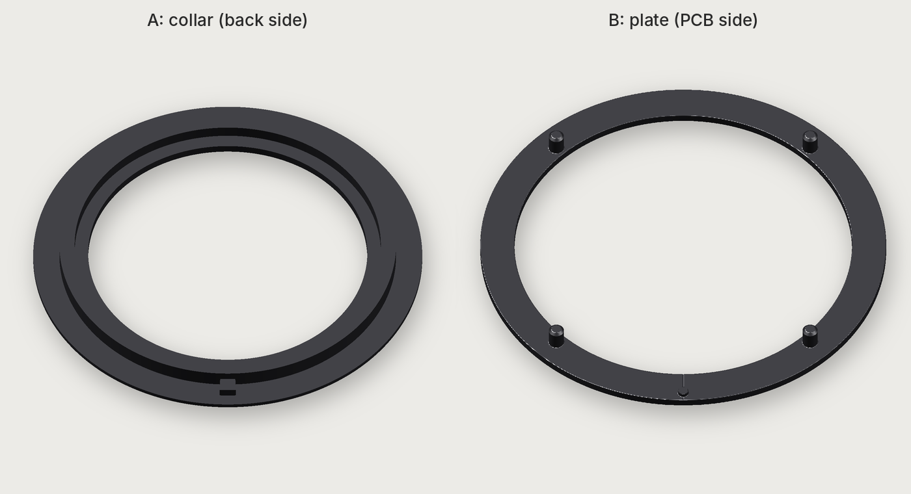

# Display mount

Two printed parts hold the round GC9A01 screen (board ZJY128S0800TG01) in the 40.3 mm hole of the steel front panel.

- **A, the collar**, goes in from the front: a 46 mm flange 0.8 mm thick, a 33 mm window with a lip that hides the edge
  of the glass, a ring that goes through the hole, and a key in the notch of the panel (A cannot turn, the notch is hidden).
- **B, the plate**, goes behind the panel: a 48 mm ring with four pegs in the four holes of the PCB (30 x 30 mm square).
  The PCB is pushed on the pegs, then held by a drop of glue or by melting the tip of the pegs with the soldering iron.

The panel is clamped between the flange of A and the plate B; the ring of A fits into the bore of B.

## Files

| File | What it is |
|---|---|
| `display_mount_plate.3mf` | The print plate (9 parts), geometry only: open it in Bambu Studio and set the print settings below |
| `display_mount.py` | Generates the parts: `python3 display_mount.py` (one pair, STL) or `python3 display_mount.py --plate` (the plate) |
| `parts.png` | Picture of the two parts |

The plate holds:

| Part | Dots on B | Use |
|---|---|---|
| 2 x collar A | | final mount (FFC cable on the J2 connector, no pin header) |
| plate B1 | 1 | reference: clearance 0.05 mm with the ring of A, pegs 1.8 mm |
| plate B2 / B3 | 2 / 3 | tighter (0) / looser (0.10 mm) on the ring of A |
| plate B4 / B5 | 4 / 5 | pegs 1.7 / 1.9 mm |
| collar A + plate B6 | 6 | temporary mount with the pin header: B is 2.3 mm thick with a blind slot for the 2 mm tips of the pins (0.25 mm of plastic left in front of the steel, no short circuit) |

Keep the B that fits best and drop the others.

## Sizes it is built on

- Panel: 1.0 mm steel, hole 40.3 mm, notch about 2.1 mm wide and 1.8 mm below the edge of the hole (measured).
- Screen (manufacturer's drawing): backlight 35.6 mm, active area 32.4 mm, glass + LCD 1.5 mm in front of the PCB,
  PCB 1.2 mm, holes 2.0 mm on a 30 x 30 mm square centred on the screen, pin row 21.2 mm above the centre.
- Final mount: the glass is 1.3 mm behind the front face, the PCB 2.8 mm.

## Printing

Bambu Lab X1 Carbon, PLA (PETG or ASA stand the heat of the machine better), 0.12 mm layers, 100 % infill
(rectilinear), no support. A prints front face down: on a smooth plate the visible face comes out glossy, on the
textured plate it is grained. B prints with the panel side down, pegs up.

## Versions

- **v2**: the version that was printed (this one).
